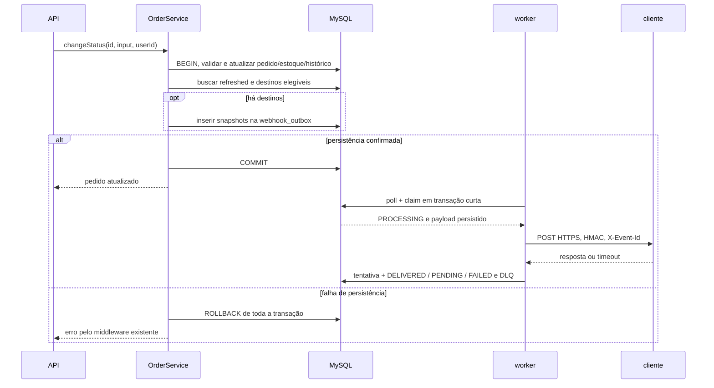
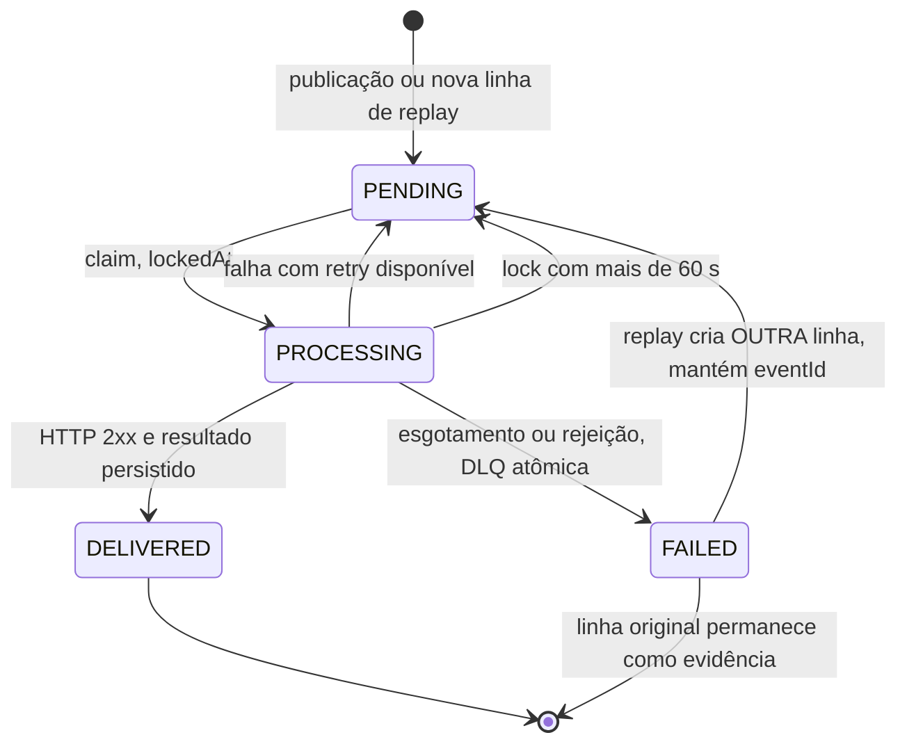

# FDD: Sistema de Webhooks de Notificação de Pedidos

Versão: 1.0

Data: 2026-10-25

Responsável técnico: Larissa (Tech Lead)

Documentos relacionados: [PRD](PRD.md), [RFC](RFC.md), [ADRs](adrs/).

## Contexto e motivação técnica

**FDD-CTX-01:** O monólito Express/Prisma já persiste pedido, histórico e operações condicionais de estoque em `OrderService.changeStatus`, mas não publica notificações (`src/modules/orders/order.service.ts`, `src/modules/orders/order.status.ts`). A extensão adiciona uma outbox na mesma transação MySQL e entrega HTTP em outro processo ([09:06] Diego, [09:40] Bruno). Motivação de produto no [PRD](PRD.md); decisões nos [ADR-001](adrs/ADR-001-outbox-transacional-no-mysql.md) a [ADR-007](adrs/ADR-007-snapshot-do-payload-na-insercao.md), sem reabrir alternativas aqui.

**FDD-CTX-02:** Atores: operador ou usuário que representa cliente chama a API com JWT; administrador executa replay; worker lê a outbox; endpoint do cliente recebe e verifica a notificação ([09:32] Marcos, [09:36] Sofia, [09:06] Diego, [09:20] Sofia). O JWT identifica usuário, sem vínculo com `Customer`: nesta fase qualquer autenticado opera configuração, rotação e histórico; somente replay exige `ADMIN` ([09:32] Larissa, [09:37] Sofia; `src/middlewares/auth.middleware.ts`, `prisma/schema.prisma`). A extensão dessa permissão à rotação e ao histórico é **Proposta de implementação (não discutida na reunião)** para manter a composição do CRUD.

**FDD-CTX-03:** Premissas e restrições: apenas outbound ([09:02] Marcos); um worker, mesmo banco e stack, instância própria de Prisma por processo ([09:11] Diego, [09:12] Diego, [09:30] Bruno); HTTPS ([09:23] Sofia). Este documento especifica código futuro, sem afirmar que o módulo já existe. Toda ocorrência abreviada de “proposta” remete a **Proposta de implementação (não discutida na reunião)**, com fundamento indicado no item. As datas e os valores concretos dos exemplos são ilustrativos. A data do cabeçalho é de produção documental, não da reunião.

## Objetivos técnicos

- **FDD-OBJ-01:** Commit de transição elegível implica persistência de todas as linhas de outbox selecionadas; falha de inserção desfaz pedido, histórico e estoque envolvidos ([09:06] Diego, [09:40] Bruno).
- **FDD-OBJ-02:** Apoiar a chegada da notificação ao cliente em menos de 10 s após mudança confirmada ([09:00] Marcos, [09:02] Marcos). **Proposta de implementação (não discutida na reunião):** medir commit da mudança (linha na outbox) até início do envio da primeira tentativa, parte controlada pelo OMS, dominada pelo polling de 2 s ([09:09] Diego, [09:10] Larissa). OMS não observa a chegada; registrar tempo de resposta no histórico ([09:34] Marcos). A resposta, com timeout de 10 s, ocorre após a chegada e não integra a meta ([09:42] Diego). Backlog pode prejudicá-la ([09:07] Bruno); FDD-OBS-01 detalha a medição.
- **FDD-OBJ-03:** **Proposta de implementação (não discutida na reunião):** adotar envio inicial e cinco retries (até seis envios) para preservar o vetor, com DLQ após esgotamento ([09:16] Diego, [09:17] Diego, [09:18] Diego). “5 tentativas” e “total 5 tentativas” conflitam com essa leitura ([09:17] Larissa, [09:48] Larissa); confirmar com Bruno e Diego ([09:50] Larissa; [ADR-003](adrs/ADR-003-retry-com-backoff-e-dead-letter-queue.md), [RFC-OQ-07](RFC.md#rfc-oq-07-contagem-de-tentativas-a-confirmar)).
- **FDD-OBJ-04:** Toda requisição outbound usa HTTPS e HMAC-SHA256 por endpoint; manter identidade do evento nas retentativas, admitindo duplicatas deduplicáveis pelo cliente ([09:22] Sofia, [09:23] Sofia, [09:25] Diego).
- **FDD-OBJ-05:** Toda tentativa HTTP concluída tem resultado consultável, payload, resposta e duração; replay exige administrador e auditoria do usuário ([09:34] Marcos, [09:36] Sofia). A fronteira em caso de crash está em FDD-FLOW-07.

## Escopo e exclusões

Incluído:

- **FDD-SCOPE-01:** Configuração por cliente: criar, listar, editar, excluir, selecionar status e rotacionar secret ([09:31] Marcos, [09:32] Larissa, [09:33] Bruno, [09:21] Sofia).
- **FDD-SCOPE-02:** Publicação transacional filtrada, snapshot, UUID, worker separado e polling ([09:34] Bruno, [09:40] Bruno, [09:51] Larissa, [09:52] Larissa, [09:11] Larissa).
- **FDD-SCOPE-03:** Histórico, retries, DLQ e replay administrativo auditado ([09:34] Marcos, [09:17] Larissa, [09:18] Diego, [09:36] Sofia).
- **FDD-SCOPE-04:** Reuso de módulos, Zod, erros e Pino, mais HTTPS, limite de payload e assinatura ([09:30] Larissa, [09:23] Sofia, [09:24] Larissa, [09:22] Sofia).

Excluído ou adiado, sem constituir requisito de implementação:

| ID | Exclusão | Fonte |
|---|---|---|
| FDD-EXC-01 | Webhooks inbound. | [09:02] Marcos |
| FDD-EXC-02 | HTTP síncrono dentro da transação; publicação fora da transação. | [09:04] Bruno, [09:41] Diego |
| FDD-EXC-03 | Redis Streams/Redis Cluster e trigger para acordar worker. | [09:07] Larissa, [09:07] Diego, [09:09] Diego |
| FDD-EXC-04 | Worker dentro da API; compartilhar uma instância de Prisma entre processos. | [09:11] Diego, [09:30] Bruno |
| FDD-EXC-05 | Ordenação global, múltiplos workers, particionamento e lock pessimista como mecanismo de escala. | [09:13] Larissa, [09:13] Diego |
| FDD-EXC-06 | Retry indefinido, política de três retries e compromisso de janela de “12 ou 24 horas”, estimativa superada pelo vetor fechado. | [09:15] Diego, [09:16] Bruno, [09:16] Diego, [09:17] Diego |
| FDD-EXC-07 | DLQ representada somente por `FAILED` na outbox, sem tabela separada. | [09:17] Larissa, [09:18] Diego |
| FDD-EXC-08 | Secret global; exigir secret fornecida pelo cliente. | [09:21] Sofia, [09:31] Marcos |
| FDD-EXC-09 | Truncar o payload outbound; tratar 500 KB como teto. | [09:23] Sofia, [09:24] Larissa |
| FDD-EXC-10 | Exactly-once e meta numérica baseada na expressão “99% dos casos”. | [09:25] Diego |
| FDD-EXC-11 | Novo logger. | [09:29] Bruno |
| FDD-EXC-12 | Extrair `customerId` do JWT. | [09:32] Bruno, [09:32] Larissa |
| FDD-EXC-13 | Filtrar destinatários apenas na hora do envio. | [09:33] Marcos, [09:34] Bruno |
| FDD-EXC-14 | Arquivamento automático e política fechada de retenção; “30 dias ou assim” e “últimos 100” não fixam retenção nem página obrigatória. | [09:08] Diego, [09:34] Marcos |
| FDD-EXC-15 | Endurecimento adicional de permissões e isolamento usuário-cliente. | [09:37] Sofia; `prisma/schema.prisma` |
| FDD-EXC-16 | Email de aviso ou fallback, inclusive gatilho de três falhas. | [09:37] Marcos, [09:37] Larissa |
| FDD-EXC-17 | Rate limiting de saída; 50 pedidos/minuto é exemplo, não limite. | [09:38] Diego, [09:39] Diego |
| FDD-EXC-18 | Dashboard visual para cliente. | [09:39] Marcos, [09:40] Larissa |
| FDD-EXC-19 | Injetar repository inteiro no `OrderService`. | [09:41] Bruno, [09:41] Diego |
| FDD-EXC-20 | `items` no payload; renderizar a partir do pedido atual durante o envio. | [09:43] Diego, [09:52] Larissa |
| FDD-EXC-21 | ID auto incremental para outbox. | [09:51] Diego, [09:51] Larissa |
| FDD-EXC-22 | Emissão na criação ou exclusão do pedido: `OrderService.create` mantém histórico inicial `PENDING`, mas só `changeStatus` é gancho de publicação. | [09:40] Bruno; `src/modules/orders/order.service.ts` |
| FDD-EXC-23 | Endpoint adicional para descobrir/listar DLQ. A reunião só definiu replay por ID. | [09:18] Diego, [09:35] Diego |
| FDD-EXC-24 | Biblioteca de métricas ou tracing distribuído/OpenTelemetry. Evolução futura não discutida, proposta fora desta entrega, preservando o reuso. | [09:30] Larissa; `package.json` |

A escolha de nomes de arquivo, localização de `customerId` e paginação, antes indefinidas, aparece como proposta nos contratos e na integração. Não se acrescenta `GET` individual de configuração.

## Modelo de dados

**FDD-DATA-01 a FDD-DATA-05:** **Proposta de implementação (não discutida na reunião):** os nomes dos quatro modelos, do enum, dos campos, das relações, dos índices adicionais e os tipos físicos abaixo são propostos para concretizar configuração, outbox, histórico e DLQ ([09:21] Bruno, [09:06] Diego, [09:34] Marcos, [09:18] Diego). Exceções de origem explícita: tabelas `webhook_outbox` ([09:06] Diego) e `webhook_dead_letter` ([09:18] Diego). Os nomes `webhooks` e `webhook_deliveries` são propostas. Seguir `prisma/schema.prisma`: camelCase, sem `@map` em colunas, `@@map` em tabelas, UUID `Char(36)`, datas e índices. Os estados técnicos traduzem [09:08] Diego; UUID segue [09:51] Larissa. Os identificadores de campo são estáveis sob o ID do modelo, por exemplo `FDD-DATA-01.customerId`.

```prisma
enum WebhookOutboxStatus {
  PENDING
  PROCESSING
  DELIVERED
  FAILED
}

model WebhookEndpoint {
  id                      String   @id @default(uuid()) @db.Char(36)
  customerId              String   @db.Char(36)
  url                     String   @db.Text
  secret                  String   @db.Text
  previousSecret          String?  @db.Text
  previousSecretExpiresAt DateTime?
  events                  Json
  active                  Boolean  @default(true)
  createdAt               DateTime @default(now())
  updatedAt               DateTime @updatedAt

  customer   Customer          @relation(fields: [customerId], references: [id], onDelete: Cascade)
  outbox     WebhookOutbox[]
  deliveries WebhookDelivery[]

  @@index([customerId])
  @@map("webhooks")
}

model WebhookOutbox {
  id            String              @id @default(uuid()) @db.Char(36)
  eventId       String              @db.Char(36)
  webhookId     String              @db.Char(36)
  orderId       String              @db.Char(36)
  payload       String              @db.LongText
  status        WebhookOutboxStatus @default(PENDING)
  attempts      Int                 @default(0)
  nextAttemptAt DateTime            @default(now())
  lockedAt      DateTime?
  createdAt     DateTime            @default(now())
  updatedAt     DateTime            @updatedAt

  webhook WebhookEndpoint @relation(fields: [webhookId], references: [id], onDelete: Cascade)

  @@index([webhookId, orderId, status, createdAt, id])
  @@index([status, nextAttemptAt])
  @@index([createdAt])
  @@index([webhookId])
  @@index([eventId])
  @@map("webhook_outbox")
}

model WebhookDelivery {
  id             String   @id @default(uuid()) @db.Char(36)
  webhookId      String   @db.Char(36)
  outboxId       String   @db.Char(36)
  eventId        String   @db.Char(36)
  attempt        Int
  success        Boolean
  responseStatus Int?
  responseBody   String?  @db.LongText
  durationMs     Int
  errorCode      String?  @db.Text
  requestPayload String   @db.LongText
  attemptedAt    DateTime @default(now())
  deadLetterId   String?  @db.Char(36)

  webhook WebhookEndpoint @relation(fields: [webhookId], references: [id], onDelete: Cascade)

  @@unique([outboxId, attempt])
  @@index([webhookId, attemptedAt])
  @@index([eventId])
  @@map("webhook_deliveries")
}

model WebhookDeadLetter {
  id           String   @id @default(uuid()) @db.Char(36)
  outboxId     String   @unique @db.Char(36)
  eventId      String   @db.Char(36)
  webhookId    String   @db.Char(36)
  payload      String   @db.LongText
  reason       String   @db.Text
  attempts     Int
  createdAt    DateTime @default(now())
  replayedAt   DateTime?
  replayedById String?  @db.Char(36)

  @@index([webhookId])
  @@index([eventId])
  @@map("webhook_dead_letter")
}
```

Em `Customer`, acrescentar somente a relação inversa `webhooks WebhookEndpoint[]` (proposta, `prisma/schema.prisma`). Não adicionar relações de outbox com `Order`, nem de auditoria com `User` (proposta): IDs escalares preservam a evidência sem introduzir bloqueios à exclusão das entidades atuais.

### FDD-DATA-01: WebhookEndpoint

Campos e relações, todos nomes propostos; o sufixo após o ID identifica o campo:

| Campo | Semântica e decisão atendida |
|---|---|
| `id` | UUID do cadastro, usado em `X-Webhook-Id` ([09:44] Sofia, [09:51] Larissa). |
| `customerId` | Cliente dono da configuração, informado na API ([09:32] Larissa). |
| `url` | Destino HTTPS, lido novamente em cada envio ([09:23] Sofia; proposta FDD-FLOW-02). |
| `secret` | Secret atual recuperável para HMAC, nunca hash unidirecional ([09:22] Sofia; proposta FDD-FLOW-06). |
| `previousSecret` | Secret anterior durante a migração de rotação ([09:21] Sofia; proposta FDD-FLOW-06). |
| `previousSecretExpiresAt` | Fim exclusivo da validade da anterior, rotação + 24 h ([09:21] Sofia; proposta). |
| `events` | `Json` contendo lista de status de destino, validada antes de gravar ([09:33] Marcos; proposta). |
| `active` | Elegibilidade para publicação; padrão `true` proposto conforme `Product.active` em `prisma/schema.prisma`. |
| `createdAt` | Criação do cadastro, padrão `now()` do schema existente. |
| `updatedAt` | Última alteração, `@updatedAt` conforme schema existente. |
| `customer` | FK para `Customer`, com cascata proposta para não criar impedimento adicional à remoção de cliente. |
| `outbox` | Relação inversa das linhas por destino, proposta para fan-out e cascata. |
| `deliveries` | Relação inversa das tentativas consultáveis ([09:34] Marcos; proposta). |

**Proposta de implementação (não discutida na reunião):** exclusão física, seguindo `src/modules/customers/customer.repository.ts`; `DELETE` do endpoint remove em cascata sua outbox, inclusive pendências, e seu histórico. Excluir cliente também propaga a remoção aos endpoints; a restrição de pedidos existentes continua a do schema atual. DLQ não tem FK para endpoint, outbox ou usuário e sobrevive às exclusões, conservando payload e `webhookId` ([09:18] Diego). Os demais IDs de ligação em histórico/DLQ são escalares por esse mesmo motivo.

**Proposta de implementação (não discutida na reunião):** persistir as secrets como texto recuperável neste desenho mínimo, para permitir HMAC sem nova dependência ou variável de ambiente (`package.json`, `src/config/env.ts`). Isso não fornece criptografia de aplicação em repouso; a forma de proteção do armazenamento exige revisão de Sofia ([09:46] Sofia; FDD-RISK-04). `LongText` permite preservar também snapshots acima do limite de envio, para diagnóstico na DLQ; não cria um novo limite de negócio.

### FDD-DATA-02: WebhookOutbox

| Campo | Semântica e decisão atendida |
|---|---|
| `id` | UUID próprio da linha por destino ([09:51] Larissa; proposta de cardinalidade FDD-FLOW-01). |
| `eventId` | UUID v4 lógico compartilhado pelo fan-out e estável em retry/replay ([09:25] Diego; proposta). |
| `webhookId` | Destino desta linha, com retry independente ([09:44] Sofia; proposta). |
| `orderId` | Pedido de origem, sem FK, apoio à correlação e limitação de ordenação ([09:12] Diego; proposta). |
| `payload` | Texto JSON imutável, serializado uma vez, sem reconstituir o pedido ([09:52] Larissa; proposta de representação FDD-API-08). |
| `status` | Estado operacional, inicialmente `PENDING` ([09:08] Diego; proposta FDD-DATA-05). |
| `attempts` | Quantidade de reservas duráveis de envio, inicialmente zero; **Proposta de implementação (não discutida na reunião):** limite de seis, a confirmar em RFC-OQ-07 ([09:17] Larissa, [09:48] Larissa, [09:17] Diego). Crash pode deixar reserva sem resultado (FDD-FLOW-07). |
| `nextAttemptAt` | Instante mínimo da próxima tentativa; inicialmente imediato, depois definido pelo vetor ([09:17] Diego; proposta). |
| `lockedAt` | Instante do claim; nulo fora de `PROCESSING`, usado na recuperação (proposta FDD-FLOW-07). |
| `createdAt` | Inserção da linha na transação; apoia leitura dos mais antigos ([09:08] Diego, [09:09] Diego; convenção do schema). |
| `updatedAt` | Última alteração operacional, conforme `@updatedAt` do schema. |
| `webhook` | FK para configuração com `onDelete: Cascade` (proposta FDD-DATA-01). |

`eventId` não é único na outbox: fan-out e replay precisam repeti-lo (proposta). Índices de status/vencimento e criação atendem [09:08] Diego; índices de ligação são propostas conforme o padrão de `prisma/schema.prisma`. **Proposta de implementação (não discutida na reunião):** o índice composto `[webhookId, orderId, status, createdAt, id]` apoia a busca de antecessores pendentes do FIFO de FDD-FLOW-02, preservando ordem por pedido com um worker ([09:12] Diego, [09:13] Larissa).

### FDD-DATA-03: WebhookDelivery

**Proposta de implementação (não discutida na reunião):** histórico por tentativa HTTP, em vez de agregado, para tornar retries e tempos individuais consultáveis ([09:34] Marcos).

| Campo | Semântica e decisão atendida |
|---|---|
| `id` | UUID do registro de tentativa, convenção de `prisma/schema.prisma`. |
| `webhookId` | Cadastro consultado pelo endpoint de histórico ([09:34] Marcos). |
| `outboxId` | Linha que originou a tentativa, escalar para diagnóstico (proposta). |
| `eventId` | Identidade lógica para correlação e deduplicação ([09:25] Diego). |
| `attempt` | Número da reserva/envio; **Proposta de implementação (não discutida na reunião):** de 1 a 6 conforme interpretação a confirmar em RFC-OQ-07 ([09:17] Larissa, [09:48] Larissa, [09:17] Diego); chave composta impede duplicar resultado da mesma reserva. |
| `success` | Verdadeiro para HTTP `2xx` dentro do prazo (proposta FDD-FLOW-02). |
| `responseStatus` | Status HTTP recebido, nulo se não houve resposta ([09:34] Marcos; proposta). |
| `responseBody` | Texto da resposta limitado a 65.536 bytes UTF-8; nulo sem corpo recebido (proposta). |
| `durationMs` | Duração inteira em milissegundos da chamada, incluindo leitura limitada da resposta ([09:34] Marcos; proposta). |
| `errorCode` | Motivo `WEBHOOK_` da falha; nulo em sucesso ([09:29] Larissa; proposta). |
| `requestPayload` | Texto exato do snapshot enviado, sem secrets ou headers ([09:34] Marcos, [09:52] Larissa; proposta). |
| `attemptedAt` | Início do envio; sobrescrever o default com o instante capturado pelo worker (proposta). |
| `deadLetterId` | ID da DLQ na última tentativa que a produziu, nulo nas demais, sem FK (proposta FDD-FLOW-04). |
| `webhook` | FK de histórico para endpoint, cascata conforme FDD-DATA-01 (proposta). |

O teto da resposta reutiliza os 64 KB de [09:24] Larissa como **Proposta de implementação (não discutida na reunião)**, para limitar armazenamento, não como decisão de truncar o payload outbound. Ler resposta em stream, reter só o prefixo que caiba em UTF-8 sem cortar caractere e cancelar o restante (proposta). Histórico sem retenção automática definida; ver [RFC-OQ-04](RFC.md#rfc-oq-04-arquivamento-e-retenção).

### FDD-DATA-04: WebhookDeadLetter

| Campo | Semântica e decisão atendida |
|---|---|
| `id` | UUID da entrada usada no replay ([09:18] Diego; convenção do schema). |
| `outboxId` | Linha original, única para evitar duplicar DLQ em recuperação (proposta). |
| `eventId` | Identidade preservada no replay ([09:25] Diego; proposta). |
| `webhookId` | Destino original, sem FK para sobreviver à exclusão (proposta). |
| `payload` | Cópia exata do snapshot, inclusive se não enviável ([09:18] Diego; proposta). |
| `reason` | Código `WEBHOOK_` da causa final, sem resposta bruta ou secret ([09:18] Diego, [09:29] Larissa; proposta). |
| `attempts` | Contador final da outbox; pode ser zero em rejeição antes do HTTP (proposta). |
| `createdAt` | Instante de entrada na DLQ, interpretação proposta do timestamp pedido em [09:18] Diego. |
| `replayedAt` | Instante do replay confirmado, nulo antes dele (proposta). |
| `replayedById` | `userId` do JWT do administrador que confirmou replay ([09:36] Sofia; proposta). |

### FDD-DATA-05: WebhookOutboxStatus

| Valor | Semântica operacional (tradução proposta de [09:08] Diego) |
|---|---|
| `PENDING` | Aguardando primeiro envio ou vencimento de retry. |
| `PROCESSING` | Linha assumida pelo worker, com `lockedAt`. |
| `DELIVERED` | HTTP confirmou sucesso segundo FDD-API-08. |
| `FAILED` | Encerramento automático com cópia confirmada na DLQ. |

## Fluxos detalhados

### FDD-FLOW-01: Criação do evento na outbox

Fontes: [09:34] Bruno, [09:40] Bruno, [09:41] Bruno, [09:41] Diego, [09:51] Larissa, [09:52] Larissa; `src/modules/orders/order.service.ts`, `src/modules/orders/order.status.ts`.

1. Em `changeStatus`, manter a transação existente: buscar pedido e itens, capturar `from`/`to`, rejeitar status idêntico e transição inválida; debitar apenas `PENDING` -> `PAID` ou repor `PAID`/`PROCESSING` -> `CANCELLED`.
2. Atualizar pedido, criar `OrderStatusHistory` e buscar `refreshed`, como hoje. Antes de `return refreshed!`, executar `await publishWebhookEvent(tx, refreshed!, from, to)` usando o mesmo `tx`. Não há HTTP nesse caminho.
3. **Proposta de implementação (não discutida na reunião):** dentro de `tx`, consultar endpoints com `customerId = refreshed.customerId`, `active = true` e filtro contendo `to`. Como o filtro é `Json`, carregar os ativos desse cliente e filtrar a lista validada em memória, evitando depender de operadores JSON particulares. Sem interessados, retornar `null` e não gerar outbox ([09:34] Bruno).
4. **Proposta de implementação (não discutida na reunião):** gerar um UUID v4 por evento lógico e um UUID por linha/destino. Todas as linhas compartilham `eventId`; o fan-out tem uma linha por endpoint selecionado e retries independentes ([09:25] Diego, [09:44] Sofia). Construir apenas os campos de FDD-API-08 com `refreshed`, `from` e `to` explícitos; `timestamp` é o instante da publicação da transição, dentro do `tx`.
5. Serializar uma única vez em UTF-8 e gravar o mesmo texto em todas as linhas `PENDING`, contador zero e `nextAttemptAt` imediato (proposta de representação e defaults). Não rejeitar a transação pelo limite outbound: esse limite será validado pelo worker (proposta FDD-RES-04).
6. Deixar qualquer falha de persistência propagar. Commit confirma pedido, histórico, estoque condicional e todas as linhas; rollback desfaz tudo. O retorno HTTP do pedido continua igual. Registrar publicação somente após confirmação do commit, conforme FDD-OBS-03 (proposta de logging).



### FDD-FLOW-02: Processamento pelo worker

Polling de [09:09] Diego; estados/índices de [09:08] Diego; timeout de [09:42] Diego. Algoritmo abaixo é **Proposta de implementação (não discutida na reunião)** para concretizar esses pontos.

1. Iniciar um processo em `src/worker.ts` (a criar), com Prisma próprio e logger compartilhado. Usar `src/modules/webhooks/webhook.processor.ts` (a criar), um dos dois nomes oferecidos em [09:28] Bruno; a escolha entre eles é proposta.
2. **Proposta de implementação (não discutida na reunião):** a cada ciclo, executar recuperação de FDD-FLOW-07. Em transação curta, selecionar até `WEBHOOK_BATCH_SIZE = 10` linhas `PENDING` com `nextAttemptAt <= agora`, em `orderBy: [{ createdAt: 'asc' }, { id: 'asc' }]`. FIFO por (`webhookId`, `orderId`): excluir candidata se existir linha do mesmo par em `PENDING` ou `PROCESSING` com `createdAt` menor ou, em empate, `id` menor, mesmo se o retry anterior ainda não venceu. Aplicar o filtro de antecessores antes do limite, via `NOT EXISTS` em SQL parametrizado no repository a criar; não filtrar somente os dez primeiros. O índice composto de FDD-DATA-02 apoia essa consulta. Selecionar no máximo uma linha por par no lote e marcar `PROCESSING`, `lockedAt = agora`. O UUID desempata deterministicamente ([09:08] Diego, [09:12] Diego, [09:13] Larissa; `prisma/schema.prisma`).
3. **Proposta de implementação (não discutida na reunião):** cada ciclo começa 2 s depois do início do anterior; se durar mais de 2 s, o seguinte começa ao fim dele, sem sobreposição ([09:09] Diego, [09:10] Larissa). Enviar as linhas do lote em paralelo, até dez, sem transação aberta durante HTTP e em um único processo worker. Com uma linha por par, manter FIFO: retry bloqueia os seguintes do mesmo pedido/endpoint até entrega ou DLQ. O ciclo dura cerca de um timeout de 10 s mais banco, em vez de dez timeouts em série ([09:42] Diego). Destinatários lentos podem atrasar novos envios em até um ciclo, ligado ao backlog ([09:07] Bruno; FDD-RISK-10). Após DLQ, os seguintes avançam; replay posterior pode entregar o antigo fora de ordem (FDD-RISK-01).
4. Para cada linha, reler configuração: usar URL e secrets atuais. Filtro `events` decide apenas a publicação de novos eventos; editar filtro não cancela linhas existentes. Inativo vai direto à DLQ com `WEBHOOK_INACTIVE`; URL inválida ou sem HTTPS, `WEBHOOK_INVALID_URL`; sem secret utilizável, `WEBHOOK_SECRET_REQUIRED`; payload acima do teto, `WEBHOOK_PAYLOAD_TOO_LARGE`. Revalidar o destino antes de enviar sustenta a invariante de HTTPS mesmo diante de configuração inconsistente (proposta, [09:23] Sofia). Não há envio nem consumo de tentativa HTTP nessas rejeições (propostas).
5. Antes de tocar a rede, reservar duravelmente a tentativa incrementando `attempts`, condicionando `status = PROCESSING`, valor esperado do contador e `lockedAt` do claim. Se já atingiu seis, encaminhar à DLQ sem novo HTTP (**Proposta de implementação (não discutida na reunião):** contagem de FDD-FLOW-03, a confirmar em RFC-OQ-07). Reservar antes evita ultrapassar o teto em crash; FDD-FLOW-07 detalha a incerteza decorrente (proposta).
6. Enviar snapshot sem reserializar com `fetch` global, HMAC via `node:crypto`, `redirect: "manual"` e `AbortController` com timer de 10.000 ms. **Proposta de implementação (não discutida na reunião):** recursos nativos de Node >=20, sem nova dependência (`package.json`); o timeout cobre envio e leitura limitada da resposta, e o timer é limpo em `finally`.
7. **Proposta de implementação (não discutida na reunião):** qualquer `2xx` dentro do prazo é sucesso; todo outro status, inclusive `3xx`, erro de rede ou timeout é falha. Não seguir redirect evita sair de HTTPS por redirecionamento ([09:23] Sofia). Sem política especial para `4xx`, `5xx` ou `Retry-After`.
8. Em nova transação curta, inserir resultado em `WebhookDelivery` e atualizar outbox: `DELIVERED`, `PENDING` com retry ou `FAILED` com DLQ. Limpar `lockedAt`; a transação de resultado usa o contador/claim esperado para evitar resultados obsoletos (proposta). Se o banco falhar depois do HTTP, não fazer novo envio imediato: recuperar por FDD-FLOW-07, admitindo duplicata.

### FDD-FLOW-03: Retry com backoff

Decisão literal: “5 tentativas, backoff 1m/5m/30m/2h/12h” ([09:17] Larissa), reiterada como “total 5 tentativas” ([09:48] Larissa). Há inconsistência: cinco intervalos implicam seis envios. “Três vezes em 30 minutos” ([09:16] Diego) e “quase 15 horas entre primeira falha e última tentativa” ([09:17] Diego) sustentam cinco retentativas após o envio inicial. **Proposta de implementação (não discutida na reunião):** adotar inicial + 5 retentativas (até 6 envios HTTP), a confirmar com Bruno e Diego na revisão ([09:50] Larissa; [RFC-OQ-07](RFC.md#rfc-oq-07-contagem-de-tentativas-a-confirmar), [ADR-003](adrs/ADR-003-retry-com-backoff-e-dead-letter-queue.md)). Cinco envios no total descartariam o intervalo de 12 h e contradiriam o vetor decidido. Tabela, cálculo e limite abaixo seguem essa proposta; não calcular fórmula exponencial nem adicionar jitter.

| Tentativa HTTP | Tipo | Espera após a falha anterior | Tempo acumulado nominal |
|---|---|---|---|
| 1 | Inicial | 0 | 0 |
| 2 | Retry 1 | 1 min | 1 min |
| 3 | Retry 2 | 5 min | 6 min |
| 4 | Retry 3 | 30 min | 36 min |
| 5 | Retry 4 | 2 h | 2 h 36 min |
| 6 | Retry 5 | 12 h | 14 h 36 min |

1. Falhou a tentativa `n < 6`: definir `nextAttemptAt = instante da falha + RETRY_DELAYS_MS[n - 1]`, `status = PENDING`, `lockedAt = null` (proposta de cálculo de vencimento).
2. Consultas ignoram linhas cujo vencimento ainda não chegou; a tabela é nominal, sem somar duração dos HTTP, polling ou backlog. Soma das esperas: `1 + 5 + 30 + 120 + 720 = 876 min`.
3. Falhou a tentativa 6: executar FDD-FLOW-04. Limite por linha de outbox e destino; replay inicia outra linha com outro orçamento, preservando evento lógico (proposta FDD-FLOW-05).

### FDD-FLOW-04: DLQ

Preservação de payload, motivo e timestamp em tabela separada: [09:18] Diego. Detalhes de transação e descoberta são **Proposta de implementação (não discutida na reunião)** para evitar perda de evidência.

1. Ao esgotar envios, ou detectar rejeição pré-envio de FDD-FLOW-02, em uma só transação marcar outbox `FAILED`, limpar lock e inserir `WebhookDeadLetter` com snapshot, `eventId`, `webhookId`, `outboxId`, contador e `reason` final. `createdAt` representa entrada na DLQ.
2. Se houve HTTP nesta passagem, vincular `deadLetterId` ao resultado da última tentativa na mesma transação. Se não houve novo HTTP, preencher o campo da última tentativa já persistida dessa outbox, se existir, sem criar tentativa fictícia (proposta).
3. Usar unicidade de `outboxId` para tornar a finalização repetida segura. Se a transação falhar, linha permanece recuperável, sem estado `FAILED` desprovido de DLQ.
4. Emitir `webhook.dead_lettered` após commit com `deadLetterId`. Administrador obtém esse ID no log ou no campo homônimo do histórico da última tentativa; não existe endpoint novo de descoberta. Em rejeição pré-envio sem tentativa anterior persistida, a descoberta é pelo log/consulta operacional SQL.

### FDD-FLOW-05: Replay administrativo

Recolocar pendente e exigir administrador auditado: [09:18] Diego, [09:36] Sofia, [09:36] Larissa. **Proposta de implementação (não discutida na reunião):** preservar identidade e consumir a elegibilidade da entrada original evita replay administrativo acidentalmente repetido.

1. Autenticar, exigir `ADMIN`, validar UUID, buscar DLQ; ausente retorna `WEBHOOK_DEAD_LETTER_NOT_FOUND`. Se já tem `replayedAt`, retornar 409 `WEBHOOK_DEAD_LETTER_ALREADY_REPLAYED`.
2. Verificar que o endpoint ainda existe; se foi excluído, retornar `WEBHOOK_NOT_FOUND`. Após reativar um endpoint inativo, o replay pode voltar a entregar; replay enquanto inativo voltará à DLQ pelo mesmo fluxo do worker.
3. Em transação, atualizar condicionalmente a entrada com `replayedAt = agora` e `replayedById = req.user.id`, somente se ainda não reexecutada. Se nenhuma linha foi atualizada, retornar 409. Criar uma nova outbox `PENDING`, novo `id`, mesmo `eventId`, mesmo `webhookId`, mesmo `orderId` extraído do snapshot e mesmos bytes de `payload`; contador zero e `nextAttemptAt = agora`.
4. Qualquer erro desfaz ambas as escritas. A outbox anterior fica `FAILED`; a DLQ permanece como evidência marcada. Se o novo ciclo falhar, criar nova entrada de DLQ, sem apagar a anterior.
5. Após commit, responder com IDs de correlação e registrar `webhook.dead_letter.replayed`, incluindo `userId` do JWT. SQL de descoberta não substitui a autorização do endpoint.

### FDD-FLOW-06: Rotação de secret

Janela de 24 h: [09:21] Sofia, [09:22] Sofia; geração pelo OMS: [09:31] Marcos. O protocolo abaixo é **Proposta de implementação (não discutida na reunião)** para tornar a convivência outbound verificável e deve passar pela revisão da Sofia ([09:46] Sofia).

1. Criar secret com `randomBytes(32).toString('hex')` de `node:crypto`, produzindo 32 bytes aleatórios representados por 64 caracteres hexadecimais. Usar a string UTF-8 resultante como chave HMAC, sem decodificá-la como hex no consumidor (proposta de representação).
2. Na criação inicial persistir apenas `secret`, anteriores nulos. Na rotação, **Proposta de implementação (não discutida na reunião):** se `previousSecretExpiresAt > agora`, recusar com 409 `WEBHOOK_SECRET_ROTATION_IN_PROGRESS`, sem alterar secrets ou prazo. Verificar e atualizar atomicamente em transação com atualização condicional que aceite somente prazo nulo ou expirado; se perder corrida para outra rotação, retornar o mesmo 409. Se permitida, mover a atual para `previousSecret`, fixar `previousSecretExpiresAt = agora + 24 h` e gravar a nova atual; devolver a nova uma única vez. Isso preserva as 24 h completas com um único campo anterior ([09:21] Sofia). Revogação emergencial imediata não foi discutida e fica para revisão de Sofia ([09:46] Sofia).
3. No envio, calcular assinatura com a atual e, enquanto `agora < previousSecretExpiresAt`, também com a anterior. Header único: `sha256=<hex atual>, sha256=<hex anterior>`; fora da janela, somente atual. O consumidor aceita qualquer assinatura válida com a secret que possui (proposta).
4. Após expirar, nunca usar a anterior. Limpar os campos expirados ao carregar a configuração para envio (proposta de limpeza sem job adicional); não há promessa de exclusão instantânea do valor armazenado no exato vencimento. Listagem, edição, histórico e replay não devolvem secrets.

### FDD-FLOW-07: Recuperação de linhas presas e shutdown

Processo separado e referência de lifecycle: [09:11] Larissa, `src/server.ts`; timeout: [09:42] Diego. Recuperação e parada são **Proposta de implementação (não discutida na reunião)** para completar o worker persistente.

1. No começo de cada ciclo, devolver a `PENDING` linhas `PROCESSING` com `lockedAt` anterior a `agora - 60 s`, limpar lock e tornar `nextAttemptAt` imediato. Não zerar `attempts`. O limiar excede o timeout de 10 s; recuperação só ocorre entre lotes, no único worker, não paralela a chamadas legítimas.
2. Reservas de tentativa são persistidas antes do HTTP. Um crash entre reserva e confirmação pode ter enviado ou não; não criar resposta fictícia no histórico. Depois de recuperar, usar a próxima reserva disponível, preservando `eventId` e payload. Pode haver lacuna na numeração do histórico. Se o contador já é seis (**Proposta de implementação (não discutida na reunião):** interpretação a confirmar em RFC-OQ-07, conforme FDD-FLOW-03) e o desfecho não foi persistido, ir à DLQ com `WEBHOOK_DELIVERY_OUTCOME_UNKNOWN`, sem sétimo envio. Essa reserva conservadora mantém o teto mesmo diante de falhas.
3. Em `SIGINT`/`SIGTERM`, parar novas buscas, cancelar espera de polling e não iniciar o restante do lote. Concluir todas as linhas já em andamento no lote paralelo, cada HTTP com limite de 10 s, persistir seus resultados e só então executar `prisma.$disconnect()` e sair. O prazo HTTP não limita indisponibilidade do banco; em interrupção forçada, recuperação fica a cargo do próximo processo.
4. Linhas já assumidas e ainda não iniciadas ficam `PROCESSING` e serão recuperadas após o limiar. Falhas do banco no loop são registradas, sem marcar entrega fictícia ou consumir nova reserva sem persistência; tentar novo ciclo no polling. Falha fatal de bootstrap sai com erro, conforme padrão de `src/server.ts`.



A seta de replay não altera o estado da linha `FAILED` original. Os diagramas representam as decisões e propostas dos fluxos acima.

## Contratos públicos

**FDD-API-BASE-01:** Prefixo `/api/v1` conforme `src/app.ts` e `src/routes/index.ts`. Métodos de CRUD: [09:31] Marcos e [09:33] Bruno; histórico e replay: [09:34] Marcos e [09:18] Diego. **Proposta de implementação (não discutida na reunião):** caminhos de cadastro, listagem por cliente, edição, exclusão e rotação abaixo, seguindo `src/modules/customers/customer.routes.ts`. `customerId` no body segue `src/modules/orders/order.schemas.ts`; os nomes públicos novos são camelCase. Não há contrato adicional de leitura individual.

**FDD-API-BASE-02:** Em todos os sete endpoints de entrada, usar `Authorization: Bearer <JWT>` obrigatório e aceitar `X-Request-Id` opcional para correlação, devolvido no header de resposta (`src/middlewares/auth.middleware.ts`, `src/middlewares/request-logger.middleware.ts`). Onde há corpo, enviar `Content-Type: application/json`, coerente com `express.json` em `src/app.ts`; não há header HMAC na chamada de gestão. IDs de path/body são UUID como em `src/modules/orders/order.schemas.ts`. Sem query significa nenhum parâmetro funcional definido além dos listados. CRUD, rotação e histórico permitem `OPERATOR` e `ADMIN`; replay somente `ADMIN` (FDD-CTX-02).

**FDD-API-BASE-03:** **Proposta de implementação (não discutida na reunião):** usar DTO público de configuração com `id`, `customerId`, `url`, `events`, `active`, `createdAt`, `updatedAt`; `secret` é acrescentada exclusivamente na criação. Semântica dos campos em FDD-DATA-01, datas ISO 8601 como na serialização de objetos atuais (`src/modules/orders/order.controller.ts`). Rotação tem DTO próprio. Em listagens, aplicar `paginated(data, page, pageSize, total)` de `src/shared/http/response.ts`; não envolver recursos individuais em `data`, conforme `src/modules/orders/order.controller.ts`. O erro usa `{ "error": { "code", "message", "details" } }`, com `details` omitido quando indefinido, exatamente como `src/middlewares/error.middleware.ts`. Mensagens pt-BR novas nos exemplos são propostas; mensagens dos erros genéricos permanecem as do código.

**FDD-API-BASE-04:** **Proposta de implementação (não discutida na reunião):** bodies de criação/edição com Zod `.strict()`, sem aceitar `secret`, `previousSecret` ou qualquer campo fora do contrato. A validação local converte erro de `url` em `WEBHOOK_INVALID_URL`, filtro inválido em `WEBHOOK_INVALID_EVENT_FILTER` e demais falhas em `WEBHOOK_VALIDATION_ERROR`, todos 400; se coexistirem, priorizar URL, filtro e demais, nessa ordem, preservando todos os detalhes de issues (proposta para resultado determinístico). Detalhes seguem `{ path: issue.path.join('.') || '(root)', message: issue.message }` de `src/middlewares/validate.middleware.ts`. Params/query continuam por `validate`, com `VALIDATION_ERROR` genérico. Fontes: [09:23] Sofia, [09:28] Bruno, [09:29] Larissa.

### FDD-API-01: POST /api/v1/webhooks

Autenticação: qualquer role autenticada. Headers: `Authorization`, `Content-Type`, `X-Request-Id` conforme FDD-API-BASE-02. Sem params/query. Body (nomes propostos):

| Campo | Obrigatoriedade e semântica |
|---|---|
| `customerId` | Obrigatório, UUID de cliente existente; não é derivado do JWT ([09:32] Larissa; convenção em `src/modules/orders/order.schemas.ts`). |
| `url` | Obrigatório, URL absoluta cujo protocolo é `https:`; Zod rejeita URL inválida/HTTP ([09:23] Sofia). |
| `events` | Obrigatório, lista não vazia e sem repetição de `PAID`, `PROCESSING`, `SHIPPED`, `DELIVERED`, `CANCELLED`. Exclusão de `PENDING` e rejeições são **Proposta de implementação (não discutida na reunião)**, pois não existe transição para `PENDING` em `src/modules/orders/order.status.ts` e criação não emite. |
| `active` | Opcional, booleano, default `true` (proposta FDD-DATA-01). |

Exemplo de requisição:

```json
{
  "customerId": "11111111-1111-4111-8111-111111111111",
  "url": "https://cliente.example/notificacoes",
  "events": ["SHIPPED", "DELIVERED"]
}
```

Sucesso 201, convenção de criação em `src/modules/orders/order.controller.ts`. Secret gerada pelo OMS e retornada uma única vez ([09:31] Marcos); valor ilustrativo de 64 caracteres hexadecimais conforme proposta FDD-FLOW-06:

```json
{
  "id": "22222222-2222-4222-8222-222222222222",
  "customerId": "11111111-1111-4111-8111-111111111111",
  "url": "https://cliente.example/notificacoes",
  "events": ["SHIPPED", "DELIVERED"],
  "active": true,
  "secret": "0123456789abcdef0123456789abcdef0123456789abcdef0123456789abcdef",
  "createdAt": "2026-10-25T12:00:00.000Z",
  "updatedAt": "2026-10-25T12:00:00.000Z"
}
```

Status: 201 criado; 400 URL/filtro/body inválido; 401 JWT ausente/inválido; 404 `WEBHOOK_CUSTOMER_NOT_FOUND` (proposta, cliente inexistente); 500 falha inesperada, conforme middleware central. Exemplo 400, URL HTTP:

```json
{
  "error": {
    "code": "WEBHOOK_INVALID_URL",
    "message": "URL de webhook deve usar HTTPS",
    "details": [{ "path": "url", "message": "URL deve usar HTTPS" }]
  }
}
```

### FDD-API-02: GET /api/v1/customers/:customerId/webhooks

Autenticação: qualquer role autenticada. Headers: `Authorization`, `X-Request-Id`; `Content-Type` desnecessário sem corpo. Param `customerId`: UUID de cliente existente ([09:33] Bruno; localização proposta). Query `page`: inteiro >=1, default 1; `pageSize`: inteiro de 1 a 100, default 20, derivados de `listOrdersQuerySchema` em `src/modules/orders/order.schemas.ts`. Sem filtros extras.

Exemplo: `GET /api/v1/customers/11111111-1111-4111-8111-111111111111/webhooks?page=1&pageSize=20`. Requisição: sem corpo.

Sucesso 200, lista em `createdAt` decrescente (proposta conforme `src/modules/orders/order.repository.ts`); cliente existente sem cadastros retorna `data: []`, total zero. Exemplo:

```json
{
  "data": [{
    "id": "22222222-2222-4222-8222-222222222222",
    "customerId": "11111111-1111-4111-8111-111111111111",
    "url": "https://cliente.example/notificacoes",
    "events": ["SHIPPED", "DELIVERED"],
    "active": true,
    "createdAt": "2026-10-25T12:00:00.000Z",
    "updatedAt": "2026-10-25T12:00:00.000Z"
  }],
  "pagination": { "page": 1, "pageSize": 20, "total": 1, "totalPages": 1 }
}
```

Status: 200 consulta; 400 `VALIDATION_ERROR` para UUID/query; 401 JWT; 404 `WEBHOOK_CUSTOMER_NOT_FOUND`; 500 inesperado. Exemplo 404 (mensagem proposta):

```json
{
  "error": {
    "code": "WEBHOOK_CUSTOMER_NOT_FOUND",
    "message": "Cliente do webhook não encontrado"
  }
}
```

### FDD-API-03: PATCH /api/v1/webhooks/:id

Autenticação: qualquer role autenticada. Headers: `Authorization`, `Content-Type`, `X-Request-Id`. Param `id`: UUID do endpoint; sem query. Body parcial com `url`, `events`, `active`, mesmas validações de FDD-API-01. **Proposta de implementação (não discutida na reunião):** exigir ao menos um campo; proibir alterar `customerId` e secrets, para manter a identidade do destino e a rotação específica ([09:33] Bruno, [09:21] Sofia). Alterações valem para próximos envios: URL atual lida no envio, `events` apenas para novas publicações, inativação para DLQ em pendências (FDD-FLOW-02).

Exemplo de requisição:

```json
{ "active": false }
```

Sucesso 200, recurso atualizado sem secrets; status baseado em `src/modules/orders/order.controller.ts` (operação de alteração):

```json
{
  "id": "22222222-2222-4222-8222-222222222222",
  "customerId": "11111111-1111-4111-8111-111111111111",
  "url": "https://cliente.example/notificacoes",
  "events": ["SHIPPED", "DELIVERED"],
  "active": false,
  "createdAt": "2026-10-25T12:00:00.000Z",
  "updatedAt": "2026-10-25T12:05:00.000Z"
}
```

Status: 200 alterado; 400 body/URL/filtro inválido ou `VALIDATION_ERROR` em param; 401 JWT; 404 `WEBHOOK_NOT_FOUND` ([09:28] Bruno); 500 inesperado. Exemplo 400 ao tentar fornecer secret:

```json
{
  "error": {
    "code": "WEBHOOK_VALIDATION_ERROR",
    "message": "Configuração de webhook inválida",
    "details": [{ "path": "(root)", "message": "Unrecognized key(s) in object: 'secret'" }]
  }
}
```

### FDD-API-04: DELETE /api/v1/webhooks/:id

Autenticação: qualquer role autenticada. Headers: `Authorization`, `X-Request-Id`; sem `Content-Type` necessário. Param `id`: UUID; sem query. Requisição: sem corpo. Exclusão física e cascatas propostas em FDD-DATA-01; não reverter chamada HTTP já iniciada, condição de corrida em FDD-RISK-08.

Sucesso 204, sem corpo de resposta, como `OrderController.delete` em `src/modules/orders/order.controller.ts` (não enviar `{}` em 204).

Status: 204 removido; 400 `VALIDATION_ERROR` para UUID; 401 JWT; 404 `WEBHOOK_NOT_FOUND`, inclusive repetição após remover (proposta conforme busca anterior à exclusão em `src/modules/orders/order.service.ts`); 500 inesperado. Exemplo 404:

```json
{
  "error": { "code": "WEBHOOK_NOT_FOUND", "message": "Webhook não encontrado" }
}
```

### FDD-API-05: POST /api/v1/webhooks/:id/rotate-secret

Autenticação: qualquer role autenticada (proposta FDD-CTX-02). Headers: `Authorization`, `X-Request-Id`; não requer `Content-Type`. Param `id`: UUID; sem query. Requisição: sem corpo. Algoritmo/janela em FDD-FLOW-06.

**Proposta de implementação (não discutida na reunião):** sucesso 200 com `id` do endpoint, nova `secret` e `previousSecretExpiresAt`, instante exclusivo do término da convivência. Não expor a anterior; nome da rota e DTO operacionalizam [09:21] Sofia seguindo a resposta direta de `src/modules/orders/order.controller.ts`.

```json
{
  "id": "22222222-2222-4222-8222-222222222222",
  "secret": "abcdef0123456789abcdef0123456789abcdef0123456789abcdef0123456789",
  "previousSecretExpiresAt": "2026-10-26T12:10:00.000Z"
}
```

Status: 200 rotacionado; 400 `VALIDATION_ERROR` em param; 401 JWT; 404 `WEBHOOK_NOT_FOUND`; **Proposta de implementação (não discutida na reunião):** 409 `WEBHOOK_SECRET_ROTATION_IN_PROGRESS` enquanto `previousSecretExpiresAt > agora`, preservando as 24 h anteriores ([09:21] Sofia; FDD-FLOW-06); 500 inesperado. Exemplo 401, mensagem real de `src/middlewares/auth.middleware.ts`:

```json
{
  "error": { "code": "UNAUTHORIZED", "message": "Missing or invalid Authorization header" }
}
```

Exemplo 409, **Proposta de implementação (não discutida na reunião):** recusa de rotação durante a janela ativa, conforme FDD-FLOW-06 ([09:21] Sofia):

```json
{
  "error": {
    "code": "WEBHOOK_SECRET_ROTATION_IN_PROGRESS",
    "message": "Rotação de secret em andamento"
  }
}
```

### FDD-API-06: GET /api/v1/webhooks/:id/deliveries

Rota e conteúdo de diagnóstico: [09:34] Marcos. Autenticação: qualquer role autenticada (proposta FDD-CTX-02). Headers: `Authorization`, `X-Request-Id`; sem `Content-Type` necessário. Param `id`: UUID do endpoint existente. Query: `page` >=1/default 1 e `pageSize` entre 1 e 100/default 20, mesma derivação de FDD-API-02. Sem corpo.

Exemplo: `GET /api/v1/webhooks/22222222-2222-4222-8222-222222222222/deliveries?page=1&pageSize=20`.

**Proposta de implementação (não discutida na reunião):** listar por `attemptedAt` decrescente e `id` como desempate. Campos do DTO correspondem a FDD-DATA-03: `requestPayload` é string com os bytes JSON preservados, não objeto reconstruído; `responseBody` é texto limitado, sem interpretar JSON; nulos indicam ausência de resposta/erro/DLQ. `deadLetterId` permite descobrir a entrada de replay. Exemplo de sucesso HTTP 200 para consulta de uma tentativa que falhou, sem envolver secrets. **Proposta de implementação (não discutida na reunião):** `attempt = 6` segue a contagem a confirmar em RFC-OQ-07 ([09:17] Diego, [09:17] Larissa, [09:48] Larissa):

```json
{
  "data": [{
    "id": "66666666-6666-4666-8666-666666666666",
    "webhookId": "22222222-2222-4222-8222-222222222222",
    "outboxId": "55555555-5555-4555-8555-555555555555",
    "eventId": "33333333-3333-4333-8333-333333333333",
    "attempt": 6,
    "success": false,
    "responseStatus": 503,
    "responseBody": "indisponível",
    "durationMs": 82,
    "errorCode": "WEBHOOK_HTTP_ERROR",
    "requestPayload": "{\"event_id\":\"33333333-3333-4333-8333-333333333333\",\"event_type\":\"order.status_changed\",\"timestamp\":\"2026-10-25T12:01:00.000Z\",\"order_id\":\"44444444-4444-4444-8444-444444444444\",\"order_number\":\"ORD-000001\",\"from_status\":\"PROCESSING\",\"to_status\":\"SHIPPED\",\"customer_id\":\"11111111-1111-4111-8111-111111111111\",\"total_cents\":10000}",
    "attemptedAt": "2026-10-26T02:37:01.000Z",
    "deadLetterId": "77777777-7777-4777-8777-777777777777"
  }],
  "pagination": { "page": 1, "pageSize": 20, "total": 1, "totalPages": 1 }
}
```

Status: 200 histórico (pode estar vazio); 400 `VALIDATION_ERROR` para params/query; 401 JWT; 404 `WEBHOOK_NOT_FOUND`; 500 inesperado. Exemplo 400 para `pageSize=101`, detalhes conforme middleware existente:

```json
{
  "error": {
    "code": "VALIDATION_ERROR",
    "message": "Validation failed",
    "details": [{ "path": "pageSize", "message": "Number must be less than or equal to 100" }]
  }
}
```

### FDD-API-07: POST /api/v1/admin/webhooks/dead-letter/:id/replay

Autenticação: `authenticate` seguido de `requireRole('ADMIN')` ([09:36] Larissa; `src/middlewares/auth.middleware.ts`, `src/modules/users/user.routes.ts`). Headers: `Authorization`, `X-Request-Id`; sem `Content-Type` necessário. Param `id`: UUID da entrada de DLQ, não do webhook; sem query. Requisição: sem corpo. Fluxo transacional em FDD-FLOW-05.

**Proposta de implementação (não discutida na reunião):** responder 200 depois do commit com `deadLetterId` da entrada consumida, `outboxId` da nova linha, `eventId` preservado e `status` inicial `PENDING`. Confirma recolocação, não entrega HTTP ([09:18] Diego; padrão de resposta direta em `src/modules/orders/order.controller.ts`).

```json
{
  "deadLetterId": "77777777-7777-4777-8777-777777777777",
  "outboxId": "88888888-8888-4888-8888-888888888888",
  "eventId": "33333333-3333-4333-8333-333333333333",
  "status": "PENDING"
}
```

Status: 200 recolocado; 400 `VALIDATION_ERROR` para UUID; 401 JWT; 403 role diferente de `ADMIN`; 404 `WEBHOOK_DEAD_LETTER_NOT_FOUND` ou `WEBHOOK_NOT_FOUND` se destino excluído; 409 `WEBHOOK_DEAD_LETTER_ALREADY_REPLAYED`; 500 inesperado. Os dois códigos específicos de DLQ são propostas para a semântica de replay. Exemplo 409:

```json
{
  "error": {
    "code": "WEBHOOK_DEAD_LETTER_ALREADY_REPLAYED",
    "message": "Entrada da DLQ já reprocessada",
    "details": { "deadLetterId": "77777777-7777-4777-8777-777777777777" }
  }
}
```

Exemplo 403 com mensagem real de `src/middlewares/auth.middleware.ts`:

```json
{
  "error": { "code": "FORBIDDEN", "message": "Insufficient permissions" }
}
```

### FDD-API-08: POST para a URL HTTPS do cliente

Autenticação outbound: secret exclusiva por endpoint e HMAC-SHA256 sobre o corpo ([09:22] Sofia); não encaminhar JWT da API. Destino é a `url` atual do cadastro, sem params/query acrescentados pelo OMS (proposta FDD-FLOW-02). É um contrato externo novo, com nomes snake_case de [09:43] Diego. Não aplicar `paginated` ou envelope de recurso ao payload.

Headers da aplicação, além dos gerados pelo transporte HTTP:

| Header | Semântica e exemplo | Origem |
|---|---|---|
| `Content-Type` | `application/json`, o corpo é JSON UTF-8. | [09:44] Diego; UTF-8 é proposta FDD-DATA-02. |
| `X-Event-Id` | `33333333-3333-4333-8333-333333333333`, UUID lógico, igual ao `event_id` do corpo em retry/replay. | [09:25] Diego, [09:44] Diego; preservação em replay proposta. |
| `X-Webhook-Id` | `22222222-2222-4222-8222-222222222222`, UUID do cadastro destinatário. | [09:44] Sofia, [09:45] Diego. |
| `X-Timestamp` | `2026-10-25T12:01:02.000Z`, instante deste envio, renova em cada tentativa, ISO 8601 proposto. Não é coberto pelo HMAC. | [09:44] Diego, [09:22] Sofia. |
| `X-Signature` | `sha256=` seguido de 64 dígitos hexadecimais minúsculos do HMAC. Na janela, duas entradas separadas por vírgula: atual primeiro, anterior depois. Exemplo de formato: `sha256=<hex atual>, sha256=<hex anterior>`. | [09:20] Sofia, [09:22] Sofia; representação e dupla assinatura são propostas FDD-FLOW-06. |

O `timestamp` do payload é imutável e representa o evento na transação; `X-Timestamp` é o instante variável do envio, inclusive no replay, e é informativo. Nenhum header, inclusive `X-Event-Id`, `X-Webhook-Id` ou `X-Timestamp`, participa da assinatura decidida sobre o corpo. O consumidor pode conferir que `X-Event-Id` corresponde ao `event_id` autenticado (proposta), mas não há proteção completa contra replay.

Payload com exatamente os campos de [09:43] Diego:

| Campo | Tipo e semântica |
|---|---|
| `event_id` | String UUID lógico gerado na publicação, para deduplicação ([09:25] Diego). |
| `event_type` | String `order.status_changed`, identifica mudança de status ([09:43] Diego). |
| `timestamp` | String ISO 8601 do instante da transição/publicação, preservada pelo snapshot ([09:43] Diego, [09:52] Larissa). |
| `order_id` | String UUID de `Order.id` em `prisma/schema.prisma`. |
| `order_number` | String de `Order.orderNumber`, exemplo `ORD-000001`, gerada por `reserveOrderNumber` em `src/modules/orders/order.service.ts`. |
| `from_status` | `OrderStatus` anterior, nunca nulo neste contrato de mudança. |
| `to_status` | `OrderStatus` novo, correspondente ao filtro aplicado. |
| `customer_id` | String UUID de `Order.customerId` em `prisma/schema.prisma`. |
| `total_cents` | Inteiro de `Order.totalCents`, total em centavos, sem conversão para decimal. |

Status e total vêm de `refreshed`, não de nova leitura no worker; não incluir `items`, dados cadastrais, notas ou outros campos. Fonte dos campos: [09:43] Diego e `prisma/schema.prisma`.

Exemplo do corpo enviado:

```json
{
  "event_id": "33333333-3333-4333-8333-333333333333",
  "event_type": "order.status_changed",
  "timestamp": "2026-10-25T12:01:00.000Z",
  "order_id": "44444444-4444-4444-8444-444444444444",
  "order_number": "ORD-000001",
  "from_status": "PROCESSING",
  "to_status": "SHIPPED",
  "customer_id": "11111111-1111-4111-8111-111111111111",
  "total_cents": 10000
}
```

**Proposta de implementação (não discutida na reunião):** os bytes efetivos são `Buffer.from(JSON.stringify(payload), 'utf8')` produzidos uma única vez na publicação, guardados como texto e usados sem reserialização em todo envio, HMAC e replay. Hex minúsculo e prefixo `sha256=` evitam ambiguidade de codificação; biblioteca nativa `node:crypto`, disponível na stack de `package.json`.

Sucesso: qualquer HTTP `2xx` dentro dos 10 s, por exemplo `204 No Content`, sem corpo. Não é necessário JSON na resposta. Detalhes atuais do pedido continuam na rota existente `GET /api/v1/orders/:id` ([09:43] Diego; `src/modules/orders/order.routes.ts`); ela não é um endpoint novo desta feature. Erro ilustrativo do cliente: HTTP 503, corpo texto `indisponível`; gerar `WEBHOOK_HTTP_ERROR` e retry. O servidor do cliente define seu envelope, portanto não exigir `{ error: ... }` dele (proposta FDD-FLOW-02). Timeout gera `WEBHOOK_TIMEOUT`; rede gera `WEBHOOK_NETWORK_ERROR`; `3xx` é falha sem seguir redirect. Não há limite de taxa nesta fase; payload <=65.536 bytes, sem truncamento (FDD-RES-04).

Exemplo TypeScript de verificação no consumidor (proposta; sem dependência nova). Receber `rawBody` antes de qualquer parse JSON, validar uma das assinaturas com uma secret conhecida e só então interpretar o payload:

```typescript
import { createHmac, timingSafeEqual } from 'node:crypto';

export function verifyWebhook(
  rawBody: Buffer,
  signatureHeader: string | undefined,
  knownSecrets: readonly string[],
): boolean {
  if (!signatureHeader || knownSecrets.length === 0) return false;
  const signatures = signatureHeader.split(',').map((part) => part.trim());
  return knownSecrets.some((secret) => {
    if (!secret) return false;
    const expected = createHmac('sha256', secret).update(rawBody).digest();
    return signatures.some((part) => {
      if (!/^sha256=[0-9a-f]{64}$/.test(part)) return false;
      const received = Buffer.from(part.slice('sha256='.length), 'hex');
      return received.length === expected.length && timingSafeEqual(received, expected);
    });
  });
}
```

Exemplo mínimo de uso: `verifyWebhook(rawBody, headers['x-signature'], [secretConhecida])` retorna `true` para o corpo intacto e uma assinatura válida; retorna `false` se um byte mudar, o header faltar ou a chave for incorreta. `timingSafeEqual` é usado só no exemplo do consumidor; o produtor usa `createHmac`. Deduplicar de forma durável pelo `event_id` verificado antes de repetir efeitos, conforme [09:25] Diego; essa deduplicação não está implementada pelo snippet. Não inventar tolerância de relógio para `X-Timestamp`.

### FDD-API-09: publishWebhookEvent(tx, order, fromStatus, toStatus)

Contrato interno proposto em [09:41] Bruno e aceito em [09:41] Diego. Implementação em `src/modules/webhooks/webhook.publisher.ts` (a criar, nome proposto). Assinatura TypeScript, reutilizando tipos presentes em `src/modules/orders/order.service.ts`:

```typescript
import type { Order, OrderStatus, Prisma } from '@prisma/client';

type PublishedWebhookEvent = {
  eventId: string;
  outboxIds: string[];
};

export declare function publishWebhookEvent(
  tx: Prisma.TransactionClient,
  order: Order,
  fromStatus: OrderStatus,
  toStatus: OrderStatus,
): Promise<PublishedWebhookEvent | null>;
```

**Proposta de implementação (não discutida na reunião):** retorno com IDs para logging após commit, ou `null` sem interessados; não é retorno HTTP. `order` é `refreshed!`, estruturalmente compatível com `Order` apesar das relações adicionais. `fromStatus` preserva o status anterior e `toStatus` é o novo; o chamador já validou a transição (`src/modules/orders/order.service.ts`). A função usa apenas os campos aprovados e o `tx` recebido, sem cliente global, transação aninhada, HTTP ou efeito externo antes do commit ([09:41] Diego, [09:52] Larissa).

Exemplo de chamada: `await publishWebhookEvent(tx, refreshed!, from, to)` imediatamente antes de retornar da callback transacional. Exemplo ilustrativo de retorno interno, após gravar um destino:

```json
{
  "eventId": "33333333-3333-4333-8333-333333333333",
  "outboxIds": ["55555555-5555-4555-8555-555555555555"]
}
```

Garantias: seleção e todas as inserções no mesmo `Prisma.TransactionClient`; zero linhas sem interessados; snapshot idêntico para o fan-out; nenhum segredo no payload; erro de persistência propagado causa rollback da transação externa ([09:34] Bruno, [09:40] Bruno, [09:41] Diego; propostas de cardinalidade em FDD-FLOW-01). Sem status HTTP próprio. Exemplo de falha: escrita da outbox rejeitada pelo banco faz a Promise rejeitar; o módulo converte a falha inesperada de escrita em `AppError` sanitizado 500 `WEBHOOK_PERSISTENCE_ERROR` e o propaga ao middleware existente. Exceção não convertida continua 500 `INTERNAL_SERVER_ERROR`, conforme o tratamento central. Não engolir a rejeição para retornar sucesso do pedido.

## Matriz de erros

Prefixo próprio: [09:29] Larissa. Os nomes `WEBHOOK_NOT_FOUND`, `WEBHOOK_INVALID_URL`, `WEBHOOK_SECRET_REQUIRED` vêm de [09:28] Bruno; a semântica do último como invariante interna é proposta, não exigência de entrada. **Proposta de implementação (não discutida na reunião):** demais códigos, condições e classes da tabela completam os contratos anteriores com o padrão de `src/shared/errors/app-error.ts` e `src/shared/errors/http-errors.ts`. Para erros próprios 404, estender diretamente `AppError`: `NotFoundError` tem código fixo `NOT_FOUND`. Não estender `ValidationError` para obter código customizado, pois também é fixo.

| ID | Código | Onde | Condição | HTTP / tratamento | Classe base |
|---|---|---|---|---|---|
| FDD-ERR-01 | `WEBHOOK_NOT_FOUND` | Gestão/histórico/replay | Endpoint não existe, inclusive destino excluído de uma DLQ. | 404; interromper operação. | `AppError`, status 404. |
| FDD-ERR-02 | `WEBHOOK_INVALID_URL` | Criar/editar; defesa no worker | Issue de Zod em `url`, inclusive protocolo diferente de HTTPS. | 400 na API, `details` com issues; no worker, DLQ direta sem HTTP (proposta). | `BadRequestError`. |
| FDD-ERR-03 | `WEBHOOK_SECRET_REQUIRED` | Worker | Não há secret atual utilizável; não usar apenas a anterior para encobrir configuração inválida (proposta). | Sem resposta HTTP da API; DLQ direta, zero envio sem assinatura. | `AppError`, 422 apenas como metadado interno. |
| FDD-ERR-04 | `WEBHOOK_CUSTOMER_NOT_FOUND` | Criar/listar | Cliente informado não existe. | 404. | `AppError`, status 404. |
| FDD-ERR-05 | `WEBHOOK_INVALID_EVENT_FILTER` | Criar/editar | Lista vazia, repetida, `PENDING` ou valor fora dos status aceitos. | 400 com issues do campo `events`. | `BadRequestError`. |
| FDD-ERR-06 | `WEBHOOK_VALIDATION_ERROR` | Body da gestão | Demais falhas de schema estrito, inclusive secret de entrada ou PATCH vazio. | 400 com array `{ path, message }`. | `BadRequestError`. |
| FDD-ERR-07 | `WEBHOOK_DEAD_LETTER_NOT_FOUND` | Replay | Entrada de DLQ inexistente. | 404. | `AppError`, status 404. |
| FDD-ERR-08 | `WEBHOOK_DEAD_LETTER_ALREADY_REPLAYED` | Replay | Entrada já consumida ou corrida perdeu atualização condicional. | 409, `details.deadLetterId`. | `ConflictError`. |
| FDD-ERR-09 | `WEBHOOK_INACTIVE` | Worker | Endpoint inativo ao reler configuração. | Sem resposta da API; DLQ direta, sem HTTP. | `UnprocessableEntityError`. |
| FDD-ERR-10 | `WEBHOOK_PAYLOAD_TOO_LARGE` | Worker/replay processado | Snapshot excede 65.536 bytes UTF-8. | Sem resposta da API; DLQ direta, sem retry/HTTP, log de erro. | `UnprocessableEntityError`. |
| FDD-ERR-11 | `WEBHOOK_TIMEOUT` | Worker | HTTP/leitura limitada não conclui dentro de 10 s. | Falha da tentativa; retry ou DLQ no teto. | `AppError`, metadado interno 504. |
| FDD-ERR-12 | `WEBHOOK_NETWORK_ERROR` | Worker | DNS, TLS, conexão ou leitura falha antes do desfecho. | Falha da tentativa; retry ou DLQ. | `AppError`, metadado interno 502. |
| FDD-ERR-13 | `WEBHOOK_HTTP_ERROR` | Worker | Resposta fora de `2xx`, inclusive `3xx`, `4xx`, `5xx`. | Registrar `responseStatus`; retry ou DLQ, sem seguir redirects. | `AppError`, metadado interno 502. |
| FDD-ERR-14 | `WEBHOOK_DELIVERY_OUTCOME_UNKNOWN` | Recuperação | **Proposta de implementação (não discutida na reunião):** sexta reserva sem resultado após crash, conforme contagem a confirmar em RFC-OQ-07 ([09:17] Diego, [09:17] Larissa, [09:48] Larissa). | DLQ sem novo envio; consumidor pode já ter recebido. | `AppError`, metadado interno 500. |
| FDD-ERR-15 | `WEBHOOK_PROCESSING_ERROR` | Worker | Falha inesperada interna/de banco no ciclo ou persistência de resultado. | Log sanitizado; não inventar resultado nem reenviar no mesmo passo; recuperar lock/ciclo. | `AppError`, metadado interno 500. |
| FDD-ERR-16 | `WEBHOOK_PERSISTENCE_ERROR` | Escritas de gestão/publicação | Falha inesperada de persistência, após identificar ausências/conflitos conhecidos. | 500; rollback, sem incluir valores sensíveis no erro. | `AppError`, status 500. |
| FDD-ERR-21 | `WEBHOOK_SECRET_ROTATION_IN_PROGRESS` | Rotação | **Proposta de implementação (não discutida na reunião):** `previousSecretExpiresAt > agora`, inclusive corrida perdida; preservar as 24 h ([09:21] Sofia; FDD-FLOW-06). | 409; não alterar secrets nem prazo. | `ConflictError`, código próprio (`src/shared/errors/http-errors.ts`). |

Os status internos de falhas do worker não são respostas ao cliente: timeout de uma chamada outbound não transforma a resposta da API de pedidos em 504. Tratar exceções dentro do processor; o middleware Express não executa ali (`src/middlewares/error.middleware.ts`). Traduzir erros conhecidos de corrida do módulo para os códigos acima; não alterar o tratamento Prisma geral.

Códigos genéricos preservados, separadamente, por virem de componentes compartilhados:

| ID | Código | Onde | Condição | HTTP / tratamento | Classe base |
|---|---|---|---|---|---|
| FDD-ERR-17 | `UNAUTHORIZED` | `authenticate` | JWT ausente, inválido ou expirado. | 401. | `UnauthorizedError`. |
| FDD-ERR-18 | `FORBIDDEN` | Replay, `requireRole` | Usuário autenticado sem `ADMIN`. | 403. | `ForbiddenError`. |
| FDD-ERR-19 | `VALIDATION_ERROR` | Params/query por `validate` | UUID/paginação inválidos. | 400, array de issues. | `ValidationError` ou `ZodError` no middleware. |
| FDD-ERR-20 | `INTERNAL_SERVER_ERROR` | Middleware central | Erro inesperado não convertido pelo módulo. | 500 com mensagem genérica. | `Error`/exceção não tratada. |

Fontes dos genéricos: `src/middlewares/auth.middleware.ts`, `src/middlewares/validate.middleware.ts`, `src/middlewares/error.middleware.ts`, `src/shared/errors/http-errors.ts`. O middleware também mantém suas conversões existentes de Prisma `P2002` -> `CONFLICT` e `P2025` -> `NOT_FOUND`, sem renomeá-las globalmente. Os erros preexistentes de pedidos, inclusive `INVALID_STATUS_TRANSITION` e `INSUFFICIENT_STOCK`, continuam intactos (`src/modules/orders/order.service.ts`). A orientação de prefixo se aplica aos erros próprios novos, compatível com o reuso de [09:29] Bruno. Os imports `@prisma/client` dos exemplos referem-se ao pacote declarado em `package.json`, não a um caminho local de código.

## Estratégias de resiliência

- **FDD-RES-01:** Timeout de 10 s com `AbortController`, abrangendo chamada e leitura limitada; limpar timer no `finally`. HTTP fora da transação do pedido, sem seguir redirecionamentos ([09:42] Diego, [09:06] Diego; propostas FDD-FLOW-02).
- **FDD-RES-02:** Vetor fixo de cinco esperas de FDD-FLOW-03; agendamento persistido, sem dormir durante o backoff de uma linha. Persistir resultado e mudança de estado juntos; preservação na DLQ é o fallback, com replay manual ([09:17] Diego, [09:18] Diego; proposta de atomicidade de resultado). Email segue fora de escopo ([09:37] Larissa).
- **FDD-RES-03:** Recuperar `PROCESSING` por `lockedAt` e encerrar ordenadamente conforme FDD-FLOW-07 (proposta). Não executar dois workers; claim condicional não equivale a suporte à escala adiada por [09:13] Diego.
- **FDD-RES-04:** **Proposta de implementação (não discutida na reunião):** interpretar 64 KB de [09:24] Larissa como `64 * 1024 = 65_536` bytes UTF-8, medidos por `Buffer.byteLength(payload, 'utf8')`. Validar no worker antes de cada envio, incluindo replay, nunca truncar outbound. Excesso não desfaz mudança de status já confirmada; vai direto à DLQ, sem HTTP ou retry. A entrada `1mb` de `express.json` em `src/app.ts` não é o limite do evento.
- **FDD-RES-05:** Idempotência dos efeitos cabe ao consumidor por `X-Event-Id` ([09:25] Diego). Produtor mantém identidade no retry e, pela proposta de replay, também entre ciclos. At-least-once admite duplicata e falhas preservadas, sem promessa de entrega eventual a cliente permanentemente indisponível ([09:24] Diego, [09:15] Diego, [09:18] Diego).
- **FDD-RES-06:** Não adotar rate limiting de saída nesta fase; observar [RFC-OQ-01](RFC.md#rfc-oq-01-rate-limiting-de-saída), conforme [09:39] Diego. **Proposta de implementação (não discutida na reunião):** também não introduzir circuit breaker, ausente da reunião e de `package.json`; reavaliá-lo na discussão operacional de RFC-OQ-01/RFC-OQ-03 se o comportamento observado justificar, sem tratá-lo como decisão já tomada.
- **FDD-RES-07:** **Proposta de implementação (não discutida na reunião):** evitar secrets, assinaturas e erros brutos com dados de configuração nos logs; aplicar redação adicional conforme FDD-INT-09. Erros novos de persistência são sanitizados antes de chegar ao middleware. Medida ligada ao incidente de [09:22] Diego; não serializar objetos completos de Prisma, requests, responses ou configuração em logs.

Parâmetros ajustáveis por código, com defaults deste desenho. **Proposta de implementação (não discutida na reunião):** os identificadores das constantes e o arquivo `src/modules/webhooks/webhook.constants.ts` (a criar) centralizam valores, evitando novos parâmetros ambientais. `src/config/env.ts` e `.env.example` não contêm configurações de webhook; não inventar novas variáveis de ambiente. Valores alteráveis por revisão de código; onde a origem é decisão da reunião, alterar a política requer revisão dessa decisão.

| Constante | Valor | Origem |
|---|---|---|
| `WEBHOOK_POLL_INTERVAL_MS` | `2_000` | [09:09] Diego, [09:10] Larissa; nome proposto. |
| `WEBHOOK_BATCH_SIZE` | `10` | **Proposta de implementação (não discutida na reunião):** lote paralelo, uma linha por par (`webhookId`, `orderId`), concretiza batch pequeno ([09:08] Diego) e FIFO ([09:12] Diego). |
| `WEBHOOK_HTTP_TIMEOUT_MS` | `10_000` | [09:42] Diego; nome proposto. |
| `RETRY_DELAYS_MS` | `[60_000, 300_000, 1_800_000, 7_200_000, 43_200_000]` | Vetor de [09:17] Diego; representação em ms proposta. |
| `WEBHOOK_MAX_RETRIES` | `5` | **Proposta de implementação (não discutida na reunião):** interpretação de cinco retentativas após inicial, a confirmar em RFC-OQ-07 ([09:16] Diego, [09:17] Diego, [09:17] Larissa, [09:48] Larissa). |
| `WEBHOOK_MAX_SENDS` | `1 + WEBHOOK_MAX_RETRIES`, isto é, `6` | **Proposta de implementação (não discutida na reunião):** mesma interpretação a confirmar, por linha da outbox (FDD-FLOW-03; [09:17] Diego, [09:48] Larissa). |
| `WEBHOOK_MAX_PAYLOAD_BYTES` | `65_536` | 64 KB de [09:24] Larissa; unidade e aplicação no worker propostas. |
| `WEBHOOK_MAX_RESPONSE_BYTES` | `65_536` | Proposta de armazenamento limitado da response de [09:34] Marcos. |
| `WEBHOOK_SECRET_GRACE_MS` | `86_400_000` | 24 h de [09:21] Sofia; conversão em ms proposta. |
| `WEBHOOK_STALE_LOCK_MS` | `60_000` | Proposta de recuperação, maior que o timeout de [09:42] Diego. |
| `WEBHOOK_DEFAULT_PAGE` | `1` | Convenção de `src/modules/orders/order.schemas.ts`. |
| `WEBHOOK_DEFAULT_PAGE_SIZE` | `20` | Mesma convenção; nome proposto. |
| `WEBHOOK_MAX_PAGE_SIZE` | `100` | Mesma convenção, não retenção de histórico. |

Invariantes:

- **FDD-INV-01:** Não confirmar transição elegível sem todas as suas linhas de outbox; ausência de interessados implica zero linhas ([09:40] Bruno, [09:34] Bruno).
- **FDD-INV-02:** Não enviar requisição sem secret/assinatura nem para URL não HTTPS ([09:22] Sofia, [09:23] Sofia; semântica proposta de `WEBHOOK_SECRET_REQUIRED`).
- **FDD-INV-03:** **Proposta de implementação (não discutida na reunião):** no máximo seis reservas/envios HTTP por linha, leitura a confirmar em RFC-OQ-07 ([09:17] Diego, [09:17] Larissa, [09:48] Larissa). Replay cria outra linha, sem reiniciar a original (FDD-FLOW-05/FDD-FLOW-07; [09:18] Diego).
- **FDD-INV-04:** Snapshot e `eventId` permanecem iguais em retry/replay; não ler pedido atual para montar o corpo ([09:52] Larissa, [09:25] Diego; proposta para replay).
- **FDD-INV-05:** Secret não é logada nem devolvida fora de criação/rotação; nunca logar `X-Signature` (proposta FDD-RES-07, incidente de [09:22] Diego).
- **FDD-INV-06:** `FAILED` implica evidência persistida na DLQ, inclusive em rejeição anterior a HTTP ([09:18] Diego; proposta de finalização atômica).
- **FDD-INV-07:** Replay é exclusivo de `ADMIN`, auditado, e uma entrada só confirma um replay ([09:36] Sofia, [09:36] Larissa; unicidade operacional proposta).
- **FDD-INV-08:** Alterações de filtro não recriam nem mutam eventos já publicados; publicação semântica ocorre somente na transição válida ([09:33] Marcos, [09:52] Larissa; proposta FDD-FLOW-02).

## Observabilidade

**Proposta de implementação (não discutida na reunião):** toda a instrumentação abaixo deriva de logs Pino e consultas SQL, sem nova biblioteca ou infraestrutura (`package.json`; reuso em [09:29] Bruno). IDs específicos de métricas e eventos são propostas, não metas adicionais. Não fixar SLO de disponibilidade, cobertura de testes, amostragem numérica ou limiares de alerta não discutidos.

### Métricas

| ID | Métrica e obtenção | Uso / origem |
|---|---|---|
| FDD-OBS-01 | **Proposta de implementação (não discutida na reunião):** latência interna: commit observado até início da primeira tentativa, correlacionando `webhook.event.published.commitObservedAt` e `webhook.delivery.started.attemptedAt` de `attempt = 1`, por `outboxId`. | OMS não observa chegada ao cliente: esse indicador da parte controlada, dominada pelo polling de 2 s, não comprova sozinho a meta de chegada <10 s ([09:00] Marcos, [09:02] Marcos, [09:09] Diego, [09:10] Larissa). Captura após resolver Promise transacional aproxima commit; tempo de resposta fica separado no histórico ([09:34] Marcos), ocorre após chegada e pode atingir timeout de 10 s ([09:42] Diego). |
| FDD-OBS-02 | Contagem por `status`, idade do `PENDING` mais antigo por `createdAt`, backlog vencido por `nextAttemptAt`, quantidade de DLQ não reexecutada, taxa de sucesso por endpoint e duração por tentativa. | SQL nas tabelas propostas, ou agregação dos eventos de log; acúmulo e diagnóstico levantados em [09:07] Bruno, [09:08] Diego, [09:34] Marcos. |

Consultas SQL ilustrativas, sobre tabelas a criar (nomes camelCase conforme FDD-DATA-01 a FDD-DATA-04):

```sql
SELECT status, COUNT(*) AS total FROM webhook_outbox GROUP BY status;
SELECT MIN(createdAt) AS oldestPendingAt, COUNT(*) AS pendingTotal
FROM webhook_outbox WHERE status = 'PENDING';
SELECT COUNT(*) AS readyTotal FROM webhook_outbox
WHERE status = 'PENDING' AND nextAttemptAt <= NOW();
SELECT COUNT(*) AS unreplayedTotal FROM webhook_dead_letter WHERE replayedAt IS NULL;
SELECT webhookId, COUNT(*) AS attempts, AVG(success) AS successRate,
       AVG(durationMs) AS averageDurationMs
FROM webhook_deliveries GROUP BY webhookId;
```

`createdAt` é instante de inserção anterior ao commit, portanto só proxy SQL de idade/latência. Não substituir silenciosamente a métrica commit -> início por inserção -> resposta. Crash pode consumir reserva sem resultado; log de início é mais fiel à primeira tentativa que inferência apenas de histórico. Identificar lacunas ao analisar FDD-OBS-01 (proposta).

### Logs

**FDD-OBS-03:** Formato estruturado Pino compartilhado (`src/shared/logger/index.ts`), sem outra biblioteca ([09:29] Bruno). **Proposta de implementação (não discutida na reunião):** usar mensagem/evento nomeado da tabela abaixo; emitir eventos de estado após commit. Campos comuns quando aplicáveis: `eventId`, `outboxId`, `webhookId`, `orderId`, `attempt`, `durationMs`, `responseStatus`, `errorCode`; acrescentar `requestId` na API e `userId` nas ações autenticadas. Campos ausentes não são preenchidos com dados inventados. Nunca logar secrets, `X-Signature`, payload/resposta brutos nem URL completa com possíveis credenciais.

| ID | Evento Pino | Campos específicos e momento | Nível proposto |
|---|---|---|---|
| FDD-OBS-04 | `webhook.event.published` | Após commit, um registro por outbox: `requestId`, `eventId`, `outboxId`, `webhookId`, `orderId`, `commitObservedAt`. | `info` |
| FDD-OBS-05 | `webhook.delivery.started` | Imediatamente antes de `fetch`, após reserva: IDs, `attempt`, `attemptedAt`. | `info` |
| FDD-OBS-06 | `webhook.delivery.succeeded` | Após resultado confirmado: IDs, `attempt`, `durationMs`, `responseStatus`. | `info` |
| FDD-OBS-07 | `webhook.delivery.failed` | IDs, `attempt`, `durationMs`, `responseStatus` se recebido, `errorCode`, `nextAttemptAt` se retry. | `warn` |
| FDD-OBS-08 | `webhook.dead_lettered` | Após commit da DLQ: IDs, `deadLetterId`, `attempts`, `errorCode`; permite descoberta sem novo endpoint. | `error` |
| FDD-OBS-09 | `webhook.dead_letter.replayed` | Após commit: `requestId`, `userId`, `deadLetterId`, `eventId`, novo `outboxId`, `webhookId`. Auditoria de [09:36] Sofia. | `info` |
| FDD-OBS-10 | `webhook.secret.rotated` | `requestId`, `userId`, `webhookId`, `previousSecretExpiresAt`; nunca valores das secrets. | `info` |
| FDD-OBS-11 | `webhook.lock.recovered` | `eventId`, `outboxId`, `webhookId`, `lockedAt` anterior, `attempts`. | `warn` |
| FDD-OBS-12 | `webhook.worker.started`, `webhook.worker.stopped` | Início: `batchSize`, `pollIntervalMs`; fim: `signal`, se recebido, e conclusão do encerramento. | `info` |
| FDD-OBS-13 | `webhook.worker.failed` | `errorCode`, fase do ciclo, IDs disponíveis; mensagem sanitizada sem objeto bruto de exceção. | `error` ou `fatal` no bootstrap |

As listas de campos e níveis são propostas para implementar os diagnósticos requeridos, apoiadas em Pino existente. Eventos sem HTTP (`WEBHOOK_INACTIVE`, payload excessivo, secret ausente) geram `webhook.dead_lettered`, não uma tentativa inventada.

### Tracing

**FDD-OBS-14:** **Proposta de implementação (não discutida na reunião):** correlação por IDs, sem spans exportados. `eventId` liga publicação, fan-out, tentativas, DLQ, replay e header `X-Event-Id`. `outboxId` distingue ciclo/destino; `webhookId` distingue cadastro. Retry/replay usam o mesmo `eventId` ([09:25] Diego; propostas de identidade).

**FDD-OBS-15:** Usar `X-Request-Id`/`req.id` de `src/middlewares/request-logger.middleware.ts` para ligar requisição de status à publicação e replay ao administrador. **Proposta de implementação (não discutida na reunião):** passar `req.id` do controller como contexto opcional de logging a `changeStatus`, mantendo retorno público e construtor; capturar retorno interno da publicação e emitir log apenas quando `$transaction` resolver. Não adicionar `requestId` ao payload externo nem alterar a assinatura de quatro argumentos do publisher. O request logger já registra `http_request` com `userId`.

**FDD-OBS-16:** Sem amostragem adicional proposta: registrar eventos de lifecycle e de todas as tentativas; controlar cardinalidade agregando métricas por status/endpoint, sem usar `eventId` como dimensão de série. IDs ficam nos logs para investigação. OpenTelemetry/spans distribuídos permanecem evolução fora de escopo, ausentes de `package.json`.

### Dashboards e alertas

**FDD-OBS-17:** **Proposta de implementação (não discutida na reunião):** entregar consultas e filtros operacionais para latência inicial, idade de pendentes, taxa de falhas e DLQ; não construir dashboard visual de cliente ([09:40] Larissa). Se a operação já possuir visualizador de logs/SQL, poderá usá-lo sem exigir ferramenta nova. A reunião não definiu plataforma de alertas, destinatários, periodicidade ou limiares operacionais: permanecem abertos. Investigar aumento do indicador interno FDD-OBS-01 e novas entradas de DLQ pelos eventos existentes, sem equiparar início do envio à meta de chegada em 10 s ([09:02] Marcos, [09:09] Diego); não criar alertas por email nesta fase ([09:37] Larissa). Retenção e escala seguem [RFC-OQ-04](RFC.md#rfc-oq-04-arquivamento-e-retenção) e [RFC-OQ-03](RFC.md#rfc-oq-03-escala-e-ordenação-com-retry).

## Integração com o sistema existente

As mudanças abaixo são especificações futuras; esta entrega altera somente este documento. Reuso decidido em [09:27] Bruno, [09:29] Bruno e [09:30] Larissa. Nomes de novas classes/métodos não presentes na reunião são **Proposta de implementação (não discutida na reunião)**, derivados dos módulos existentes.

### FDD-INT-01: src/modules/orders/order.service.ts

**Hoje:** `OrderService` recebe `OrderRepository` e `PrismaClient`. `changeStatus` executa `$transaction`, busca pedido e itens, preserva `from`, define `to`, valida transição, chama estoque condicionalmente, atualiza `order`, cria `orderStatusHistory` e consulta `refreshed` antes de `return refreshed!`. `create` grava pedido e histórico inicial, sem gancho de eventos.

**Mudança/uso:** importar publisher do módulo a criar e inserir exatamente `await publishWebhookEvent(tx, refreshed!, from, to)` entre a consulta de `refreshed` e `return refreshed!`. Não abrir outra transação nem capturar o erro para permitir commit parcial ([09:40] Bruno, [09:41] Diego). Construtor continua `OrderService(orderRepository, prisma)`, pois a função recebe o `tx`, sem injetar repository inteiro ([09:41] Bruno, [09:41] Diego). **Proposta de implementação (não discutida na reunião):** para FDD-OBS-15, acrescentar somente contexto opcional `requestId` ao método, guardar IDs retornados pelo publisher em variável local à chamada, aguardar a resolução de `$transaction` e então logar publicação antes de retornar o mesmo pedido. Não logar sucesso dentro da callback, pois ela ainda pode sofrer rollback. Nenhuma emissão em `create` ou `delete`.

### FDD-INT-02: src/shared/errors/app-error.ts

**Hoje:** `AppError(message, statusCode, errorCode, details?)` guarda os quatro elementos e captura stack.

**Mudança/uso:** arquivo compartilhado não precisa mudar. Erros novos em arquivo do módulo a criar estendem `AppError` diretamente para 404 e metadados internos do worker; usar códigos de FDD-ERR-01 a FDD-ERR-16 e FDD-ERR-21. Não expor secrets em `message` ou `details` ([09:28] Bruno, [09:29] Larissa; proposta de sanitização FDD-RES-07).

### FDD-INT-03: src/shared/errors/http-errors.ts

**Hoje:** `BadRequestError`, `ConflictError` e `UnprocessableEntityError` aceitam código customizado; `NotFoundError` fixa `NOT_FOUND` e `ValidationError` fixa `VALIDATION_ERROR`. `InsufficientStockError` e `InvalidStatusTransitionError` exemplificam erros de domínio.

**Mudança/uso:** manter classes compartilhadas; estender as parametrizáveis no módulo para 400/409/422, conforme matriz. Não usar `NotFoundError('Webhook')` esperando código `WEBHOOK_NOT_FOUND` ([09:28] Bruno; limites concretos deste arquivo).

### FDD-INT-04: src/middlewares/error.middleware.ts

**Hoje:** `errorMiddleware` serializa `AppError`, `ZodError`, Prisma `P2002`/`P2025` e erro inesperado; omite `details` indefinido e loga erro inesperado com `requestId`.

**Mudança/uso:** inalterado ([09:29] Bruno). Controllers novos fazem `next(err)`; o módulo converte seus erros antes dessa fronteira, sem renomear genéricos. Worker tem `try/catch` próprio e logs sanitizados; não é coberto pelo middleware Express.

### FDD-INT-05: src/middlewares/auth.middleware.ts

**Hoje:** `authenticate` verifica bearer JWT e popula `req.user` com `id`, `email`, `role`; `requireRole(...roles)` retorna 401 sem usuário e 403 fora das roles. Não há `customerId` no token.

**Mudança/uso:** reutilizar `authenticate` em todas as rotas novas. No replay, compor `authenticate` e `requireRole('ADMIN')` ([09:36] Larissa), como em `src/modules/users/user.routes.ts`. Usar `req.user.id` na auditoria; não inferir cliente do JWT nem implementar vínculo inexistente ([09:32] Larissa; FDD-CTX-02).

### FDD-INT-06: src/middlewares/validate.middleware.ts

**Hoje:** `validate` faz parse de body/query/params, atribui valores normalizados à requisição e converte `ZodError` em `ValidationError` com `details` de `{ path, message }`.

**Mudança/uso:** arquivo compartilhado permanece. Reutilizar para UUIDs e paginação; no módulo, propor validador específico de body baseado nos schemas Zod estritos, convertendo URL/filtro/demais falhas em códigos `WEBHOOK_`, sem deixar Zod escapar como erro genérico para esses bodies (FDD-API-BASE-04; [09:23] Sofia, [09:29] Larissa).

### FDD-INT-07: src/app.ts

**Hoje:** `buildControllers(prisma)` monta repositories, services e controllers e retorna `Controllers`. `buildApp` instala `express.json({ limit: '1mb' })`, `requestLogger`, healthcheck, `buildApiRouter` sob `/api/v1` e `errorMiddleware`.

**Mudança/uso:** **Proposta de implementação (não discutida na reunião):** em `buildControllers`, criar `WebhookRepository`, `WebhookService` e `WebhookController` (todos a criar no módulo) com a mesma instância injetada e retornar chave `webhooks`. Manter a montagem do `OrderService`, o prefixo e a cadeia de middlewares. O parser `1mb` continua independente do limite outbound ([09:27] Bruno, [09:30] Larissa).

### FDD-INT-08: src/routes/index.ts

**Hoje:** `Controllers` contém `auth`, `users`, `customers`, `products`, `orders`; `buildApiRouter` monta os cinco routers.

**Mudança/uso:** **Proposta de implementação (não discutida na reunião):** acrescentar `webhooks` ao tipo e importar os builders do módulo a criar. Montar dois pontos novos: `router.use('/webhooks', buildWebhookRouter(controllers.webhooks))` para configuração, rotação e histórico; `router.use('/admin/webhooks', buildAdminWebhookRouter(controllers.webhooks))` para replay. Registrar também `router.get('/customers/:customerId/webhooks', authenticate, validate(...), controllers.webhooks.listByCustomer)` neste agregador, sem criar terceiro router montado. O router atual de customers não tem rota terminal que capture esse sufixo. Ambos os mount points e a rota por cliente ficam sob `/api/v1` por `src/app.ts`; não duplicar o prefixo ([09:33] Bruno, [09:34] Marcos, [09:35] Diego).

### FDD-INT-09: src/shared/logger/index.ts

**Hoje:** `createLogger` usa Pino com `redactPaths` para authorization, cookie, password/hash e tokens, base `service: 'order-management-api'`, `env` e timestamp ISO. Não cobre secrets do webhook.

**Mudança/uso:** reutilizar `logger` na API e no worker ([09:29] Bruno). **Proposta de implementação (não discutida na reunião):** ampliar `redactPaths` para `secret`, `previousSecret`, `*.secret`, `*.previousSecret`, além de caminhos de assinatura nos objetos de request, caso apareçam incidentalmente; nunca incluir `X-Signature` nos eventos do módulo. Acrescentar contexto `component: 'webhook-worker'` no logger filho do worker, sem substituir a biblioteca. A redação de propriedades não limpa secrets interpoladas em strings, por isso sanitizar antes de logar (incidente de [09:22] Diego; FDD-RES-07).

### FDD-INT-10: src/config/database.ts

**Hoje:** `createPrismaClient()` constrói `PrismaClient` com níveis de log conforme ambiente e o módulo exporta `prisma = createPrismaClient()` imediatamente.

**Mudança/uso:** worker usa instância criada por `createPrismaClient` no seu próprio processo, com a mesma `DATABASE_URL` ([09:30] Bruno). **Proposta de implementação (não discutida na reunião):** importar o `prisma` já exportado neste processo, como o servidor faz, evitando chamar a fábrica uma segunda vez após importá-la e criar um cliente extra inutilizado. A fábrica e o singleton pertencem a cada processo Node, não são compartilhados entre API e worker. Worker chama `$connect()` no bootstrap e `$disconnect()` na parada; não criar cliente por ciclo.

### FDD-INT-11: src/server.ts

**Hoje:** `bootstrap` monta a API, inicia HTTP e instala `SIGINT`/`SIGTERM`; `shutdown` chama `server.close`, mas não espera seu callback antes de `$disconnect()` e `process.exit(0)`. Catch fatal de bootstrap loga e sai com código 1.

**Mudança/uso:** referência para `src/worker.ts` (a criar), conforme [09:11] Larissa. Worker não abre porta HTTP e implementa a espera explícita da linha em andamento de FDD-FLOW-07 (proposta); não atribuir ao servidor existente uma drenagem que ele não implementa, nem alterá-lo nesta feature.

### FDD-INT-12: prisma/schema.prisma

**Hoje:** provider MySQL, entidades UUID com `Char(36)`, camelCase e `@@map`, enums `UserRole`/`OrderStatus`, sem tabelas de webhook. `OrderItem` e `OrderStatusHistory` têm cascata a partir de `Order`.

**Mudança/uso:** adicionar quatro modelos, enum e inversa em `Customer` de FDD-DATA-01 a FDD-DATA-05, como migração aditiva futura. Não mudar enums atuais nem criar FK que passe a impedir exclusão de pedido. Índices sustentam leitura por estado e criação ([09:08] Diego); UUID segue [09:51] Larissa. Migração não é executada nesta entrega.

### FDD-INT-13: src/shared/http/response.ts

**Hoje:** `Pagination` contém `page`, `pageSize`, `total`, `totalPages`; `paginated` retorna `{ data, pagination }`; `buildPagination` calcula `Math.ceil(total / pageSize)`.

**Mudança/uso:** reutilizar sem alteração em listas de endpoints e de entregas (proposta de paginação). Total zero gera `totalPages = 0`. Não criar envelopes divergentes dos exemplos de FDD-API-02/FDD-API-06 ([09:30] Larissa; convenção existente).

### FDD-INT-14: package.json

**Hoje:** ESM, Node >=20; scripts `dev` com `tsx`, `build` com `tsc`, `start` com Node para `dist/server.js`; sem script `worker`. Dependências já cobrem Prisma, Zod, Pino e testes.

**Mudança/uso:** criar script `worker` para `npm run worker` ([09:11] Larissa). **Proposta de implementação (não discutida na reunião):** `"worker": "tsx --env-file=.env src/worker.ts"`, derivado do `dev` existente, sem `watch`. Para operação com build e sem devDependencies, usar o artefato `dist/worker.js` (a criar na compilação) com Node e carregamento de ambiente no mesmo padrão de `start`. `fetch`, `AbortController` e `node:crypto` são nativos; não acrescentar dependências. Nenhum comando é executado por este documento.

### FDD-INT-15: tests/setup.ts

**Hoje:** `beforeAll` conecta Prisma; `beforeEach` limpa histórico, itens, pedidos, sequência, produtos, clientes e usuários; `afterAll` desconecta.

**Mudança/uso:** **Proposta de implementação (não discutida na reunião):** limpar novas tabelas antes das entidades atuais, na ordem `WebhookDelivery`, `WebhookDeadLetter`, `WebhookOutbox`, `WebhookEndpoint`, para isolamento determinístico dos testes. A DLQ sem FK precisa de limpeza explícita. Não iniciar loop de worker automaticamente no setup; testar processor de modo controlado (referência de testes em [09:46] Larissa).

### FDD-INT-16: tests/helpers/factories.ts

**Hoje:** `getTestApp` guarda app criado por `buildApp({ prisma })`; `createTestUser`, `loginAndGetToken`, `bootstrapAuthenticatedUser`, `createTestCustomer` e `createTestProduct` produzem dados e JWTs reais para Supertest.

**Mudança/uso:** **Proposta de implementação (não discutida na reunião):** reutilizar helpers para cliente e roles, acrescentar factory de endpoint com secret exclusivamente de teste; permitir configurar filtro, atividade e pendências para cenários da seção de aceite. Evitar secret real e não imprimir resposta de criação/rotação nos testes (reuso de stack em [09:30] Larissa).

### FDD-INT-17: src/modules/orders/order.status.ts

**Hoje:** `canTransition`, `allowedTransitions`, `isTerminal`, `shouldDebitStock` e `shouldReplenishStock` definem a máquina e as condições de estoque. Não há transição com destino `PENDING`.

**Mudança/uso:** arquivo inalterado. Derivar valores aceitos no filtro dos destinos possíveis e testar rejeição de `PENDING`; não alterar transições nem relacionar publicação apenas ao débito (proposta de filtro, FDD-API-01; integração de [09:40] Bruno).

### FDD-INT-18: src/modules/orders/order.schemas.ts

**Hoje:** schemas Zod usam UUID, `customerId` camelCase e `OrderStatus`; `listOrdersQuerySchema` tem `page=1`, `pageSize=20`, máximo 100.

**Mudança/uso:** convenção para schemas do módulo a criar: IDs, campo `customerId` de criação e paginação (propostas de contrato). Não importar o schema inteiro de pedidos para validar webhooks; reutilizar o padrão com campos próprios ([09:30] Larissa).

### FDD-INT-19: src/middlewares/request-logger.middleware.ts

**Hoje:** `requestLogger` usa `x-request-id` recebido ou UUID v4, define `req.id`, devolve `X-Request-Id` e emite `http_request` ao finalizar, com `userId` e duração por relógio monotônico.

**Mudança/uso:** arquivo inalterado; propagar `req.id` para os logs de publicação/replay (proposta FDD-OBS-15). Usar relógio monotônico para `durationMs` do HTTP, seguindo o cálculo existente. Não enviar automaticamente todos os headers da requisição da API ao cliente.

### FDD-INT-20: tests/orders.test.ts

**Hoje:** Vitest + Supertest testam criação, totais, `PENDING` -> `PAID`, transições inválidas, falta de estoque, reposição no cancelamento, filtro e recusa de exclusão em estado indevido; consultam Prisma para conferir estoque.

**Mudança/uso:** acrescentar verificações de outbox e rollback integrado sem alterar expectativas dos contratos existentes (proposta; testes ponta a ponta citados em [09:46] Larissa). Manter essa suíte como regressão; a especificação dos novos testes está em FDD-AC-01 a FDD-AC-18.

### FDD-INT-21: src/modules/orders/order.controller.ts

**Hoje:** `OrderController.changeStatus` exige `req.user`, chama o service com `id`, body e `req.user.id`, responde 200 com pedido; todos os handlers encaminham erros a `next`.

**Mudança/uso:** **Proposta de implementação (não discutida na reunião):** passar `req.id` como quarto argumento opcional de contexto de logging em `changeStatus`, conforme FDD-INT-01/FDD-OBS-15. Manter payload de entrada e resposta. Esse arquivo também referencia o estilo do novo controller: 201 na criação, 200 na atualização/listagem e 204 sem corpo na exclusão ([09:30] Larissa; convenções reais).

Arquivos novos, todos **a criar**. **Proposta de implementação (não discutida na reunião):** nomes e divisão abaixo seguem o padrão do módulo de pedidos ([09:27] Bruno), salvo entrada e processor já sugeridos na reunião; a escolha de `webhook.processor.ts` dentre os dois nomes é proposta ([09:28] Bruno).

| ID | Caminho | Estado | Responsabilidade |
|---|---|---|---|
| FDD-NEW-01 | `src/modules/webhooks/webhook.controller.ts` | a criar | Handlers e DTOs públicos, encaminhamento de erros. |
| FDD-NEW-02 | `src/modules/webhooks/webhook.service.ts` | a criar | CRUD, rotação, histórico e replay transacional. |
| FDD-NEW-03 | `src/modules/webhooks/webhook.repository.ts` | a criar | Persistência de configuração, listagens e operações com o cliente recebido. |
| FDD-NEW-04 | `src/modules/webhooks/webhook.routes.ts` | a criar | Builders normal/admin e composição de autenticação/validação. |
| FDD-NEW-05 | `src/modules/webhooks/webhook.schemas.ts` | a criar | Zod e validador de body com conversão de códigos. |
| FDD-NEW-06 | `src/modules/webhooks/webhook.publisher.ts` | a criar | `publishWebhookEvent`, seleção e snapshot no `tx` do pedido. |
| FDD-NEW-07 | `src/modules/webhooks/webhook.processor.ts` | a criar | Ciclo, claim, envio assinado, resultados, retry, DLQ e recuperação. |
| FDD-NEW-08 | `src/modules/webhooks/webhook.errors.ts` | a criar | Classes e motivos com prefixo `WEBHOOK_`. |
| FDD-NEW-09 | `src/modules/webhooks/webhook.constants.ts` | a criar | Constantes da tabela de resiliência. |
| FDD-NEW-10 | `src/worker.ts` | a criar | Bootstrap, Prisma por processo e sinais de shutdown. |

## Dependências e compatibilidade

**FDD-DEP-01:** Base mínima adotada para esta implementação: versões efetivamente declaradas, sem inferir suporte a versões anteriores. Origem das linhas abaixo: `package.json`, exceto MySQL, de `docker-compose.yml`. Não é necessária dependência nova (proposta FDD-FLOW-02).

| Componente | Versão mínima | Observações |
|---|---|---|
| Node.js | `>=20` | `engines.node`; ESM, `fetch`, `AbortController`, `node:crypto`. |
| TypeScript | `5.6.3` | Versão declarada para compilação. |
| Express | `4.21.1` | Routers, handlers e middleware existentes. |
| Prisma / `@prisma/client` | `5.22.0` | Mesmo gerador/cliente e transações; regenerar cliente na implementação. |
| MySQL | `8.0` | Imagem atual, único serviço do Compose. |
| Zod | `3.23.8` | Schemas, URL e validações próprias. |
| Pino | `9.5.0` | Logger compartilhado; não introduzir outro logger. |
| `uuid` | `11.0.3` | `v4` já usado pelo request logger. |
| `tsx` | `4.19.2` | Script de desenvolvimento do worker proposto. |
| Vitest | `2.1.4` | Testes conforme suíte existente. |
| Supertest | `7.0.0` | Contratos HTTP conforme suíte existente. |

- **FDD-DEP-02:** Preservar endpoints e corpos existentes: retorno de `changeStatus`, validações de transição, estoque e erros de pedidos continuam iguais; alterações só acrescentam publicação/rotas ([09:40] Bruno, [09:41] Bruno; `src/modules/orders/order.service.ts`, `src/modules/orders/order.controller.ts`). Falha da nova escrita pode abortar a transição, efeito deliberado da atomicidade.
- **FDD-DEP-03:** **Proposta de implementação (não discutida na reunião):** migração aditiva com quatro tabelas, enum e índices, sem reescrever dados ou remover colunas existentes; API e worker devem usar cliente Prisma gerado para o schema ampliado antes de ativar o envio (`prisma/schema.prisma`; persistência decidida em [09:06] Diego, [09:18] Diego).
- **FDD-DEP-04:** Mesmo MySQL e stack, nenhum serviço novo de fila. Worker é novo processo operacional, não nova infraestrutura de mensagens ([09:07] Diego, [09:11] Diego). Compose atual não implanta API/worker; não presumir configuração de deploy já existente (`docker-compose.yml`).
- **FDD-DEP-05:** Configuração ambiental atual reutilizada, inclusive `DATABASE_URL`; worker carrega o mesmo validador de ambiente, que também exige `JWT_SECRET`, embora ele não autentique inbound (`src/config/env.ts`, `.env.example`). Não criar variável de chave de criptografia nem parâmetros ambientais de retry sem nova decisão; proteção em repouso permanece revisão de segurança.

## Critérios de aceite técnicos

Checklist para a implementação futura; não representa testes executados nesta entrega documental. **Proposta de implementação (não discutida na reunião):** métodos de verificação abaixo concretizam as decisões citadas, usando a stack de `tests/orders.test.ts` e `package.json`, sem meta nova de cobertura.

- [ ] **FDD-AC-01:** Integração Vitest + Supertest: configurar dois endpoints ativos interessados e um não interessado; mudar status válido gera duas linhas com IDs distintos, mesmo `eventId` e mesmo snapshot, e mantém retorno de pedidos. Sem interessados/inativos, zero linhas. Verifica FDD-FLOW-01 ([09:34] Bruno).
- [ ] **FDD-AC-02:** Integração: provocar falha na escrita da outbox durante transição que movimenta estoque; conferir rollback de status, histórico, estoque e todas as linhas do fan-out. Validar também transições sem movimentação de estoque. Verifica FDD-OBJ-01 ([09:40] Bruno; `src/modules/orders/order.status.ts`).
- [ ] **FDD-AC-03:** Integração: criação de pedido e transição recusada não emitem evento; filtros vazio, repetido ou `PENDING` retornam `WEBHOOK_INVALID_EVENT_FILTER`. Verifica FDD-EXC-22/FDD-API-01 ([09:40] Bruno; máquina atual).
- [ ] **FDD-AC-04:** Integração Vitest + Supertest: exercitar os sete endpoints, status e envelopes; paginação default 20, máximo 100 e total zero; `details` conforme matriz. Conferir que secret não aparece em listagem, PATCH, histórico ou replay. Verifica contratos e `src/shared/http/response.ts`.
- [ ] **FDD-AC-05:** Unitário de schemas e integração: HTTP/URL inválida retorna `WEBHOOK_INVALID_URL`; campo `secret` recebido retorna `WEBHOOK_VALIDATION_ERROR`; params/query inválidos mantêm `VALIDATION_ERROR`. Verifica FDD-API-BASE-04 ([09:23] Sofia, [09:29] Larissa).
- [ ] **FDD-AC-06:** Integração: sem JWT, 401; `OPERATOR` usa CRUD/rotação/histórico, mas recebe 403 no replay; `ADMIN` confirma replay e auditoria contém `userId`. Não presumir vínculo usuário-cliente inexistente. Verifica [09:37] Sofia, [09:36] Larissa.
- [ ] **FDD-AC-07:** **Proposta de implementação (não discutida na reunião):** testar claim de até dez vencidos por `createdAt, id`, lock e envio paralelo, com no máximo uma linha por par (`webhookId`, `orderId`). Um retry bloqueia eventos seguintes do mesmo par mesmo sem vencimento; outros pares avançam. Entrega ou DLQ libera o seguinte; replay após DLQ pode chegar fora de ordem. Conferir filtro de antecessores antes do limite e cadência: início a início de 2 s, ou próximo imediato ao terminar ciclo mais longo, sem sobreposição. Verifica FDD-FLOW-02 ([09:08] Diego, [09:09] Diego, [09:10] Larissa, [09:12] Diego, [09:13] Larissa, [09:18] Diego).
- [ ] **FDD-AC-08:** Unitário com timers controlados: `2xx` confirma; timeout aborta aos 10 s; rede, `3xx`, `4xx`, `5xx` consomem tentativa; redirect não é seguido; vetor produz vencimentos 1 min, 6 min, 36 min, 2 h 36 min, 14 h 36 min em relógio nominal sem duração de chamadas. Após seis falhas, exatamente uma DLQ: **Proposta de implementação (não discutida na reunião):** contagem a confirmar em RFC-OQ-07. Verifica FDD-FLOW-03 ([09:17] Diego, [09:17] Larissa, [09:48] Larissa, [09:50] Larissa, [09:42] Diego).
- [ ] **FDD-AC-09:** Unitário: 65.536 bytes UTF-8 são aceitos; 65.537 são recusados sem HTTP/retry e com DLQ, inclusive no replay; usar caracteres multibyte para distinguir bytes de caracteres. Integração confirma que publicação não aborta por esse limite. Verifica FDD-RES-04 ([09:24] Larissa; interpretação proposta).
- [ ] **FDD-AC-10:** Unitário: HMAC calculado sobre snapshot bruto verifica com o snippet; alterar byte falha. Conferir todos os headers e distinção dos timestamps, nenhum campo extra no payload. Verifica FDD-API-08 ([09:22] Sofia, [09:43] Diego, [09:44] Diego, [09:44] Sofia).
- [ ] **FDD-AC-11:** Unitário com relógio: rotação emite duas assinaturas antes de 24 h, só a nova no instante da expiração; **Proposta de implementação (não discutida na reunião):** segunda rotação durante `previousSecretExpiresAt > agora` retorna 409 `WEBHOOK_SECRET_ROTATION_IN_PROGRESS`, inclusive sob concorrência, sem mudar secrets/prazo. A anterior conserva as 24 h completas; no instante da expiração nova rotação é permitida. Secret nova gerada e devolvida apenas na operação de criação/rotação. Revisão manual de Sofia valida protocolo e armazenamento. Verifica FDD-FLOW-06 ([09:21] Sofia, [09:46] Sofia).
- [ ] **FDD-AC-12:** Integração: duas requisições administrativas concorrentes à mesma DLQ confirmam somente uma nova outbox, outra 409; IDs/payload preservados, contador zero, vencimento imediato. Nova falha gera outra DLQ; destino excluído retorna 404. Verifica FDD-FLOW-05 ([09:18] Diego; propostas de replay).
- [ ] **FDD-AC-13:** Integração: desativar pendência causa DLQ `WEBHOOK_INACTIVE`; reativar e fazer replay permite novo envio. Editar URL altera próximo destino sem alterar snapshot; excluir endpoint remove outbox/histórico e conserva DLQ. Verifica FDD-DATA-01/FDD-FLOW-02 ([09:21] Bruno, [09:33] Bruno; propostas).
- [ ] **FDD-AC-14:** Unitário e integração: simular crash após reserva e após HTTP antes de persistir resultado; após 60 s a linha é recuperada com mesmo evento e contador preservado. **Proposta de implementação (não discutida na reunião):** sexta reserva sem resultado produz `WEBHOOK_DELIVERY_OUTCOME_UNKNOWN`, sem sétimo envio, segundo contagem de FDD-FLOW-03 a confirmar em RFC-OQ-07 ([09:17] Larissa, [09:48] Larissa, [09:17] Diego). Conferir duplicata possível e ausência de resultado fictício. Verifica FDD-FLOW-07 ([09:24] Diego; proposta de recuperação).
- [ ] **FDD-AC-15:** **Proposta de implementação (não discutida na reunião):** integração controlada/manual: enviar `SIGTERM` e `SIGINT` durante lote; worker para buscas, conclui todas as linhas já em andamento no lote paralelo dentro do timeout HTTP de cada uma quando banco responde e desconecta após persistir. Restante do lote recuperável no próximo processo. Verifica FDD-FLOW-07 ([09:11] Larissa, [09:42] Diego).
- [ ] **FDD-AC-16:** Unitário com captura de logs e revisão manual: eventos têm IDs correlacionáveis; publicação só aparece após commit; replay tem `userId`; nenhum log contém secret, anterior, assinatura ou corpo de resposta. Consultas SQL conferem estados/DLQ; validar `X-Request-Id` até publicação. Verifica FDD-OBS-01 a FDD-OBS-17 ([09:22] Diego, [09:29] Bruno, [09:36] Sofia).
- [ ] **FDD-AC-17:** **Proposta de implementação (não discutida na reunião):** em cenário controlado com worker ativo, sem backlog e cliente responsivo, registrar commit observado, início da primeira tentativa e chegada no destinatário simulado. Conferir meta de chegada <10 s, sem equiparar o indicador interno ao recebimento; resposta é medida separadamente no histórico. Repetir com destinatário lento/backlog para demonstrar limites sem criar carga numérica obrigatória ou garantia universal. OMS não observa chegada em produção. Verifica FDD-OBJ-02 ([09:00] Marcos, [09:02] Marcos, [09:09] Diego, [09:07] Bruno, [09:34] Marcos, [09:42] Diego).
- [ ] **FDD-AC-18:** Integração de regressão da suíte existente de pedidos e revisão de migração/build: endpoints, corpos, estoque e erros atuais preservados; só tabelas/enum/índices adicionais, script worker e arquivos previstos; sem dependência ou infraestrutura nova. Revisão de segurança de Sofia antes do deploy, com ao menos dois dias úteis reservados dentro da estimativa consolidada de três sprints ([09:46] Sofia, [09:47] Larissa; `tests/orders.test.ts`, `package.json`, `prisma/schema.prisma`).

## Riscos e mitigação

Probabilidades são avaliações da autora, não frequências informadas na reunião. Mitigações e contingências operacionais não fechadas na reunião são **Proposta de implementação (não discutida na reunião)**; remetem aos fluxos especificados. A priorização não acrescenta SLO nem compromisso de prazo.

### FDD-RISK-01: Bloqueio por pedido e replay fora de ordem após DLQ

**Probabilidade:** média (avaliação da autora): backoff longo e DLQ com replay manual ([09:17] Diego, [09:18] Diego).

**Impacto:** **Proposta de implementação (não discutida na reunião):** falha persistente segura eventos seguintes do mesmo pedido/endpoint até a DLQ; o mesmo endpoint provavelmente também falharia. Depois da DLQ, os seguintes avançam e replay posterior entrega o antigo fora de ordem (FDD-FLOW-02).

**Mitigação:**

- **Proposta de implementação (não discutida na reunião):** FIFO por (`webhookId`, `orderId`) e índice composto preservam a ordem durante retries ([09:12] Diego, [09:13] Larissa; FDD-DATA-02).
- Preservar `from_status`, `to_status`, `timestamp` para diagnóstico do replay ([09:43] Diego).

**Plano de contingência:** revisar ordenação de replay e escala em [RFC-OQ-03](RFC.md#rfc-oq-03-escala-e-ordenação-com-retry), sem introduzir múltiplos workers nesta fase ([09:13] Diego).

### FDD-RISK-02: Linhas presas em PROCESSING

**Probabilidade:** média (avaliação da autora): há processo persistente separado sujeito a reinícios ([09:11] Diego); claim e HTTP não pertencem à mesma transação, por desenho.

**Impacto:** entrega parada, duplicata após recuperação ou resultado desconhecido no fim do orçamento.

**Mitigação:**

- Recuperação por `lockedAt` de 60 s, reserva durável e resultado atômico (propostas FDD-FLOW-07/FDD-FLOW-02).
- **Proposta de implementação (não discutida na reunião):** shutdown aguarda todas as linhas já em andamento no lote paralelo antes de desconectar; não manter transação aberta durante rede ([09:11] Larissa; FDD-FLOW-07).

**Plano de contingência:** inspecionar logs de recuperação e DLQ; executar replay administrativo auditado se necessário. Conferir efeitos no consumidor, que pode ter recebido a chamada antes do crash ([09:24] Diego, [09:25] Diego).

### FDD-RISK-03: Crescimento da outbox e histórico sem arquivamento

**Probabilidade:** alta (avaliação da autora): linhas se acumulam e arquivamento foi explicitamente adiado ([09:07] Bruno, [09:08] Diego); histórico também não tem retenção definida ([09:34] Marcos).

**Impacto:** consultas mais lentas, pressão no MySQL e atraso que pode prejudicar a meta de chegada ao cliente ([09:02] Marcos, [09:07] Bruno).

**Mitigação:**

- Índices por estado/vencimento e criação, batch pequeno ([09:08] Diego; proposta de composição dos índices).
- Medir backlog, idade e volume de DLQ por SQL/Pino (proposta FDD-OBS-02).

**Plano de contingência:** levar evidência a [RFC-OQ-04](RFC.md#rfc-oq-04-arquivamento-e-retenção) e RFC-OQ-03 antes de definir retenção/escala. Não apagar evidência automaticamente ou adotar “30 dias” como requisito.

### FDD-RISK-04: Exposição de secret em logs ou armazenamento

**Probabilidade:** média (avaliação da autora): já houve vazamento em log de cliente ([09:22] Diego), `redactPaths` atual não inclui secrets (`src/shared/logger/index.ts`) e o modelo proposto guarda texto recuperável.

**Impacto:** falsificação de notificações do endpoint comprometido e perda de confiança na integração.

**Mitigação:**

- Secret individual, criação/rotação como únicas respostas que a expõem ([09:21] Sofia, [09:31] Marcos; proposta de DTO).
- Redação adicional e logs sem secrets/assinatura/objetos brutos; testar ausência inclusive em caminhos de erro (FDD-RES-07).
- Submeter geração, dupla assinatura e proteção em repouso à revisão de Sofia ([09:46] Sofia); criptografia de aplicação não está definida neste desenho.

**Plano de contingência:** rotacionar o endpoint afetado e revisar o incidente com Sofia. A janela de 24 h mantém a anterior válida por desenho; revogação emergencial imediata não foi discutida e demanda decisão, sem prometer que a rotação comum a implementa.

### FDD-RISK-05: X-Timestamp não autenticado

**Probabilidade:** média (avaliação da autora): o header de envio foi sugerido para detectar replay ([09:44] Diego), mas HMAC cobre somente corpo ([09:22] Sofia).

**Impacto:** adulterar timestamp não invalida assinatura; verificação temporal isolada oferece proteção limitada contra replay.

**Mitigação:**

- Informar a limitação no contrato e não prometer proteção completa contra replay.
- Verificar corpo bruto e usar identidade autenticada do payload para deduplicação ([09:25] Diego; exemplo proposto FDD-API-08).

**Plano de contingência:** revisão de segurança em [RFC-OQ-06](RFC.md#rfc-oq-06-revisão-de-segurança) avalia evolução do conteúdo assinado, sem mudar unilateralmente o contrato atual ([09:46] Sofia).

### FDD-RISK-06: Destinos HTTPS apontando para rede interna

**Probabilidade:** média (avaliação da autora): só HTTPS foi exigido ([09:23] Sofia), sem política discutida de endereços IP, DNS ou redes internas.

**Impacto:** processo com acesso à rede interna pode alcançar destinos indevidos por URLs cadastradas; HTTPS sozinho não delimita endereço de rede.

**Mitigação:**

- Não seguir redirects, proposta já descrita em FDD-FLOW-02.
- Registrar a exposição para revisão de Sofia, sem transformar bloqueio de IPs internos em requisito aprovado ([09:46] Sofia).

**Plano de contingência:** Sofia e operação avaliam controles de destino/rede antes do deploy no âmbito de [RFC-OQ-06](RFC.md#rfc-oq-06-revisão-de-segurança). Nenhuma lista de bloqueio ou biblioteca nova é presumida.

### FDD-RISK-07: Cadastro público aceita role ADMIN

**Probabilidade:** alta (avaliação da autora): `src/modules/auth/auth.routes.ts` registra `/register` sem autenticação, `src/modules/auth/auth.schemas.ts` aceita `ADMIN` e `src/modules/users/user.service.ts` persiste a role recebida.

**Impacto:** a restrição local de replay por role não garante provisionamento confiável de administradores. É limitação preexistente, fora do escopo desta feature.

**Mitigação:**

- Implementar exatamente `authenticate` + `requireRole('ADMIN')`, com auditoria ([09:36] Larissa, [09:36] Sofia).
- Expor o achado à revisão de segurança e à questão de permissões [RFC-OQ-05](RFC.md#rfc-oq-05-permissões-da-configuração), sem alterar silenciosamente auth.

**Plano de contingência:** tratar o provisionamento de roles em demanda própria revisada por segurança; este FDD não especifica correção no módulo de autenticação.

### FDD-RISK-08: Edição ou exclusão durante envio

**Probabilidade:** média (avaliação da autora): PATCH/DELETE são funcionais ([09:33] Bruno), enquanto HTTP ocorre fora de transação ([09:06] Diego); há intervalo entre releitura de configuração e chamada.

**Impacto:** uma chamada já iniciada pode usar URL/secret anteriores ou terminar após exclusão; a cascata pode remover dados necessários para persistir seu histórico.

**Mitigação:**

- Reler configuração imediatamente antes de enviar, com semântica de próximas tentativas explícita (proposta FDD-FLOW-02).
- Não prometer cancelamento retroativo; sanitizar resultado e detectar ausência ao persistir, sem recriar cadastro ou pendência removidos (proposta).

**Plano de contingência:** registrar `webhook.worker.failed` com `WEBHOOK_NOT_FOUND` e IDs se exclusão impedir persistência; não reconstituir filas deliberadamente excluídas. Evidência já existente na DLQ permanece preservada (proposta FDD-DATA-01).

### FDD-RISK-09: Destinatário indisponível e duplicatas

**Probabilidade:** alta (avaliação da autora): manutenção de duas horas já ocorreu ([09:16] Diego) e duplicatas são admitidas ([09:24] Diego).

**Impacto:** esgotamento sem entrega ou efeitos duplicados no consumidor; timeout pode acontecer depois de o cliente ter aplicado o evento.

**Mitigação:**

- Backoff fechado, identidade estável e histórico por tentativa ([09:17] Diego, [09:25] Diego; proposta de histórico).
- Documentar deduplicação e não prometer recebimento eventual incondicional ([09:26] Marcos, [09:15] Diego).

**Plano de contingência:** restabelecido o destino, replay administrativo auditado da DLQ, conservando `eventId` para deduplicação ([09:18] Diego, [09:36] Sofia; proposta FDD-FLOW-05).

### FDD-RISK-10: Lote lento prejudica latência inicial

**Probabilidade:** média (avaliação da autora): chamadas podem consumir 10 s ([09:42] Diego) e backlog foi levantado ([09:07] Bruno); o lote proposto é paralelo, mas o próximo ciclo espera sua conclusão (FDD-FLOW-02).

**Impacto:** **Proposta de implementação (não discutida na reunião):** destinatários lentos podem atrasar novos envios em até um ciclo, cerca de um timeout de 10 s mais banco. Backlog e espera por FIFO também afetam a chegada ao cliente em menos de 10 s ([09:02] Marcos, [09:07] Bruno, [09:42] Diego; FDD-FLOW-02).

**Mitigação:**

- Medir commit observado até primeiro envio e idade dos pendentes separadamente da duração HTTP (propostas FDD-OBS-01/FDD-OBS-02).
- **Proposta de implementação (não discutida na reunião):** manter lotes paralelos pequenos, uma linha por par, índices e cadência de início a início sem sobreposição ([09:08] Diego, [09:09] Diego, [09:10] Larissa; FDD-FLOW-02).

**Plano de contingência:** revisar evidências em [RFC-OQ-03](RFC.md#rfc-oq-03-escala-e-ordenação-com-retry), mantendo o único processo e o paralelismo limitado pelo FIFO de FDD-FLOW-02 ([09:13] Diego).

Redigido com apoio de IA a partir de `TRANSCRICAO.md` e do código; rastreabilidade em `docs/TRACKER.md`.
