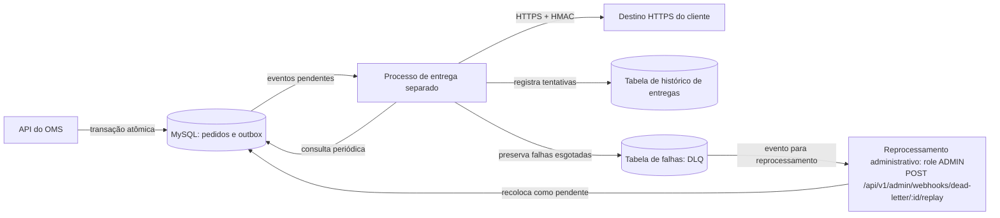

# RFC: Sistema de Webhooks de Notificação de Pedidos

## Metadados

| Campo | Valor |
|---|---|
| Título | Sistema de Webhooks de Notificação de Pedidos |
| Autora | Larissa (Tech Lead), conforme [09:50] Larissa |
| Status | Em revisão |
| Data | 2026-10-25 (produção do documento, não data da reunião) |
| Revisores | Marcos (Product Manager), Bruno (Engenheiro Pleno, Pedidos), Diego (Engenheiro Sênior, Plataforma), Sofia (Engenheira de Segurança), conforme cabeçalho de `TRANSCRICAO.md` |
| Origem | Reunião técnica registrada em `TRANSCRICAO.md` |
| Documentos relacionados | [PRD](PRD.md), [FDD](FDD.md), [ADRs](adrs/README.md) |

## Resumo executivo (TL;DR)

- Registrar notificações outbound atomicamente com a mudança de status no MySQL existente (RFC-PROP-02).
- Entregar por worker separado, com polling de 2 segundos (RFC-PROP-03).
- Preservar snapshot, admitir duplicatas e permitir deduplicação pelo consumidor (RFC-PROP-05, RFC-PROP-10).
- Recuperar falhas com backoff, DLQ e replay administrativo auditado (RFC-PROP-08, RFC-PROP-09).
- Exigir HTTPS e HMAC por endpoint; submeter os detalhes de segurança à revisão de Sofia (RFC-PROP-13, RFC-OQ-06).

## Contexto e problema

RFC-CTX-01: Atlas Comercial, MaxDistribuição e Nova Cargo solicitaram notificações; consultas periódicas tornam a integração lenta e cara, e Atlas sinalizou risco de migração ao concorrente ([09:00] Marcos). O [PRD](PRD.md) concentra objetivos e escopo de produto.

RFC-CTX-02: `src/modules/orders/order.service.ts` persiste mudanças de status sem publicar eventos. `package.json` não declara mecanismos de eventos ou filas; `docker-compose.yml` contém apenas MySQL. A proposta aproveita esse banco para um time pequeno ([09:07] Diego). O escopo é outbound ([09:02] Marcos).

## Proposta técnica

Componentes e responsabilidades:

- **RFC-PROP-01:** Criar `src/modules/webhooks/` (a criar), responsável por configuração, publicação e processamento, seguindo módulos, Zod, `AppError`, Pino e tratamento HTTP existentes ([09:27] Bruno, [09:28] Bruno, [09:30] Larissa; [ADR-006]).
- **RFC-PROP-02:** Persistir no mesmo MySQL configurações, outbox transacional, histórico de entregas e DLQ em tabelas novas. A outbox representa trabalho pendente; histórico apoia diagnóstico; DLQ preserva falhas esgotadas ([09:06] Diego, [09:18] Diego, [09:21] Bruno, [09:34] Marcos; [ADR-001], [ADR-003]).
- **RFC-PROP-03:** Executar um worker separado da API, inicialmente único, com polling de 2 segundos; mesmo banco e stack, instância própria de Prisma ([09:09] Diego, [09:11] Diego, [09:12] Diego, [09:30] Bruno; [ADR-002], [ADR-006]).

Fluxo de ponta a ponta:

1. **RFC-PROP-04:** A API recebe a mudança de status. Dentro da transação de `changeStatus`, seleciona os webhooks interessados no status de destino; sem interessados, não publica ([09:34] Bruno, [09:40] Bruno; [ADR-001]).
2. **RFC-PROP-05:** Persiste o snapshot renderizado da transição junto do pedido e histórico, mantendo as operações condicionais de estoque existentes. Commit confirma ambos; falha na outbox provoca rollback ([09:40] Bruno, [09:52] Larissa; `src/modules/orders/order.service.ts`; [ADR-001], [ADR-007]).
3. **RFC-PROP-06:** Após o commit, o worker consulta os pendentes mais antigos e assume a entrega fora da transação de pedidos ([09:06] Diego, [09:09] Diego; [ADR-002]).
4. **RFC-PROP-07:** Envia o snapshot ao cliente via HTTPS, assinado com HMAC-SHA256, e identifica o evento em `X-Event-Id` ([09:22] Sofia, [09:23] Sofia, [09:25] Diego; [ADR-004], [ADR-005]).
5. **RFC-PROP-08:** Registrar histórico, retentar pelo vetor fechado e encaminhar esgotamento à DLQ ([09:17] Larissa, [09:18] Diego, [09:34] Marcos). **Proposta de implementação (não discutida na reunião):** inicial + 5 retentativas, até 6 envios; validar em RFC-OQ-07 e [ADR-003] ([09:16] Diego, [09:17] Diego, [09:48] Larissa, [09:50] Larissa).
6. **RFC-PROP-09:** Um administrador pode recolocar o evento da DLQ na outbox por replay manual. Exigir `ADMIN` e registrar quem executou a ação ([09:18] Diego, [09:36] Sofia, [09:36] Larissa; [ADR-003], [ADR-006]).

Garantias, limites e segurança:

- **RFC-PROP-10:** Atomicidade cobre mudança elegível e registro do evento. At-least-once admite duplicatas, deduplicadas pelo cliente com `X-Event-Id`; o esgotamento preserva o evento na DLQ, sem prometer recebimento eventual por cliente permanentemente indisponível ([09:06] Diego, [09:15] Diego, [09:18] Diego, [09:25] Diego; [ADR-001], [ADR-005]).
- **RFC-PROP-11:** Ordem por `order_id` com um worker, sem ordem global ([09:12] Diego, [09:13] Larissa, [09:14] Marcos; [ADR-002]). **Proposta de implementação (não discutida na reunião):** FIFO por (`webhookId`, `orderId`): anterior por (`createdAt`, `id`) em `PENDING`/`PROCESSING` bloqueia seguinte até entrega ou DLQ; índice composto apoia consulta (`prisma/schema.prisma`). Após DLQ, seguintes avançam; replay pode chegar fora de ordem. Contexto: `from_status`, `to_status`, `timestamp` ([09:18] Diego, [09:43] Diego).
- **RFC-PROP-12:** Meta: chegada ao cliente em menos de 10 s após mudança confirmada ([09:00] Marcos, [09:02] Marcos). **Proposta de implementação (não discutida na reunião):** medir commit (outbox) até início da primeira tentativa, dominado pelo polling de 2 s ([09:09] Diego, [09:10] Larissa). OMS não observa chegada; backlog atrasa ([09:07] Bruno). Histórico registra duração ([09:34] Marcos), após chegada, timeout 10 s fora da meta ([09:42] Diego; [ADR-002]).
- **RFC-PROP-13:** HTTPS obrigatório; assinatura sobre o corpo com secret exclusiva por endpoint, gerada pela plataforma. Rotação mantém a anterior válida por 24 horas; protocolo de convivência aguarda validação em RFC-OQ-06 ([09:21] Sofia, [09:22] Sofia, [09:23] Sofia, [09:31] Marcos; [ADR-004]).

O FDD detalhará [Fluxos detalhados](FDD.md#fluxos-detalhados), [Contratos públicos](FDD.md#contratos-públicos) e [Estratégias de resiliência](FDD.md#estratégias-de-resiliência).

## Alternativas consideradas

### RFC-ALT-01: HTTP síncrono em changeStatus

Levantado por [09:03] Larissa e descartado: cliente lento bloquearia a transação e indisponibilidade externa criaria o dilema do rollback ([09:04] Bruno). Prevaleceu entrega assíncrona, registrada no [ADR-001].

### RFC-ALT-02: Redis Streams

Levantado por [09:07] Larissa. Acrescentaria infraestrutura de fila; o custo operacional foi considerado excessivo para o time pequeno, enquanto MySQL atendia à necessidade ([09:07] Diego; [ADR-001]).

### RFC-ALT-03: Trigger para acordar o worker

Proposta por [09:09] Bruno para maior reatividade. MySQL não oferece o `NOTIFY/LISTEN` citado como comparação com Postgres; trigger executa SQL sem notificar diretamente outro processo, exigindo improvisações ([09:09] Diego). Polling foi escolhido no [ADR-002].

### RFC-ALT-04: Worker no processo da API

Explicitamente afastado por [09:11] Diego: compartilhar o processo acoplaria o worker aos reinícios da API. A independência operacional prevaleceu no [ADR-002].

### RFC-ALT-05: Exactly-once

Comparado e descartado por [09:25] Diego: eliminar duplicatas exigiria coordenação bilateral e maior complexidade. O [ADR-005] registra a escolha de at-least-once com deduplicação pelo consumidor.

### RFC-ALT-06: Renderizar o payload no envio

[09:51] Bruno contrapôs guardar apenas `order_id` ao payload renderizado. Ler o pedido depois poderia alterar o significado da transição; prevaleceu fidelidade temporal pelo snapshot ([09:52] Larissa; [ADR-007]).

## Questões em aberto

Os gatilhos abaixo são propostas da autora para orientar a revisão, não compromissos definidos na reunião.

### RFC-OQ-01: Rate limiting de saída

Rajadas foram levantadas por [09:38] Diego; posição atual: observar e decidir se virar problema ([09:39] Diego, [09:39] Larissa). Gatilho proposto: evidência de sobrecarga nos destinatários.

### RFC-OQ-02: Aviso de falhas por email

[09:37] Marcos pediu aviso após falhas consecutivas. [09:37] Larissa adiou para possível próxima fase após medir impacto. Gatilho proposto: impacto observado justificar revisar esse escopo; nenhum limiar foi aprovado.

### RFC-OQ-03: Escala e ordenação com retry

Múltiplos workers, particionamento por `order_id` e lock pessimista ficaram para o futuro ([09:12] Diego, [09:13] Diego). FIFO: RFC-PROP-11; replay após DLQ pode chegar fora de ordem ([09:18] Diego, [09:43] Diego). Gatilho proposto: backlog ou necessidade de ordenar também replays.

### RFC-OQ-04: Arquivamento e retenção

[09:08] Diego adiou arquivamento de entregues, citando “30 dias ou assim”, sem política exata. [09:34] Marcos pediu histórico, sem definir retenção. Posição: arquivamento futuro, retenção em aberto. Gatilho proposto: crescimento persistido pressionar armazenamento ou consultas.

### RFC-OQ-05: Permissões da configuração

[09:37] Sofia aceitou qualquer role autenticada nesta fase e deixou endurecimento para depois. JWT não vincula usuário a cliente (`src/middlewares/auth.middleware.ts`, `prisma/schema.prisma`). Gatilho proposto: revisão de segurança demandar restrição adicional; isolamento por cliente não está decidido. O registro público aceita `role`, risco preexistente fora do escopo a levar à revisão de segurança (`src/modules/auth/auth.routes.ts`, `src/modules/auth/auth.schemas.ts`).

### RFC-OQ-06: Revisão de segurança

[09:46] Sofia reservou revisão de HMAC e geração de secret antes do deploy. **Proposta de implementação (não discutida na reunião):** validar nessa revisão dupla assinatura durante rotação, armazenamento das secrets e restrições de destino além de HTTPS, para completar o protocolo e avaliar exposição. `X-Timestamp` foi pensado para detecção opcional de replay ([09:44] Diego), mas não é autenticado pela assinatura sobre o corpo ([09:22] Sofia). Avaliar sua inclusão no conteúdo assinado também é proposta para essa revisão, sem decisão atual ([ADR-004]). Gatilho: disponibilização do desenho e código de segurança para Sofia.

### RFC-OQ-07: Contagem de tentativas a confirmar

“5 tentativas”/“total 5 tentativas” ([09:17] Larissa, [09:48] Larissa) conflitam com cinco intervalos e quase 15 horas ([09:16] Diego, [09:17] Diego). **Proposta de implementação (não discutida na reunião):** inicial + 5 retentativas (6 envios); cinco envios descartariam 12 h. Validar com Bruno e Diego ([09:50] Larissa; [ADR-003]).

## Impacto e riscos

RFC-INT-01: Estender a transação de `OrderService.changeStatus` com a publicação, sem envio HTTP dentro dela ([09:40] Bruno, [09:41] Diego; `src/modules/orders/order.service.ts`). A integração detalhada ficará no [FDD](FDD.md#integração-com-o-sistema-existente).

RFC-INT-02: Operar novo processo e novas tabelas, sem nova infraestrutura de fila, conforme RFC-PROP-02 e RFC-PROP-03. `package.json` ainda não oferece script de worker. **Proposta de implementação (não discutida na reunião):** usar recursos nativos de Node para HTTP e criptografia, evitando dependência adicional; a stack declarada permite essa opção. Observabilidade ficará no [FDD](FDD.md#observabilidade).

Probabilidades são avaliações da autora, apoiadas nos fatos citados, não frequências medidas.

| ID | Risco | Probabilidade | Impacto | Mitigação |
|---|---|---|---|---|
| RFC-RISK-01 | Backlog no MySQL | Média: acúmulo levantado por [09:07] Bruno | Latência acima da meta | Índices e leitura seletiva ([09:08] Diego); RFC-OQ-03 e RFC-OQ-04 |
| RFC-RISK-02 | Destinatário indisponível | Alta: manutenção já durou duas horas ([09:16] Diego) | Esgotamento sem entrega | Backoff, DLQ e replay ([ADR-003]) |
| RFC-RISK-03 | Recebimento duplicado | Alta por desenho ([09:24] Diego) | Repetição de efeitos no consumidor | Deduplicação por `X-Event-Id` ([09:25] Diego; [ADR-005]) |
| RFC-RISK-04 | Vazamento de secret | Média: incidente anterior ([09:22] Diego) | Comprometimento do endpoint | Secret individual, rotação e revisão ([09:21] Sofia; RFC-OQ-06) |
| RFC-RISK-05 | Bloqueio durante retry e replay fora de ordem após DLQ | Média: backoff longo ([09:17] Diego), proposta RFC-PROP-11 | Falha persistente segura eventos do mesmo pedido/endpoint até DLQ; replay antigo pode chegar depois | FIFO proposto e contexto da transição ([09:12] Diego, [09:13] Larissa, [09:18] Diego, [09:43] Diego); RFC-OQ-03 |

## Decisões relacionadas

| ADR | Decisão | Link |
|---|---|---|
| ADR-001 | Outbox transacional no MySQL | [Registro](adrs/ADR-001-outbox-transacional-no-mysql.md) |
| ADR-002 | Worker separado com polling | [Registro](adrs/ADR-002-worker-separado-com-polling.md) |
| ADR-003 | Backoff e DLQ | [Registro](adrs/ADR-003-retry-com-backoff-e-dead-letter-queue.md) |
| ADR-004 | HMAC e secret por endpoint | [Registro](adrs/ADR-004-assinatura-hmac-sha256-com-secret-por-endpoint.md) |
| ADR-005 | At-least-once com X-Event-Id | [Registro](adrs/ADR-005-entrega-at-least-once-com-x-event-id.md) |
| ADR-006 | Reuso dos padrões existentes | [Registro](adrs/ADR-006-reuso-dos-padroes-existentes-do-projeto.md) |
| ADR-007 | Snapshot na inserção | [Registro](adrs/ADR-007-snapshot-do-payload-na-insercao.md) |

## Próximos passos

RFC-NEXT-01: Revisar com Bruno e Diego antes da implementação ([09:50] Larissa). Reservar pelo menos dois dias úteis para Sofia antes do deploy ([09:46] Sofia), dentro da estimativa de três sprints, sem converter em datas de entrega ([09:46] Larissa, [09:47] Larissa).

[ADR-001]: adrs/ADR-001-outbox-transacional-no-mysql.md
[ADR-002]: adrs/ADR-002-worker-separado-com-polling.md
[ADR-003]: adrs/ADR-003-retry-com-backoff-e-dead-letter-queue.md
[ADR-004]: adrs/ADR-004-assinatura-hmac-sha256-com-secret-por-endpoint.md
[ADR-005]: adrs/ADR-005-entrega-at-least-once-com-x-event-id.md
[ADR-006]: adrs/ADR-006-reuso-dos-padroes-existentes-do-projeto.md
[ADR-007]: adrs/ADR-007-snapshot-do-payload-na-insercao.md

Redigido com apoio de IA a partir de `TRANSCRICAO.md` e do código; rastreabilidade em `docs/TRACKER.md`.
